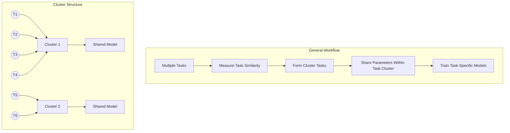
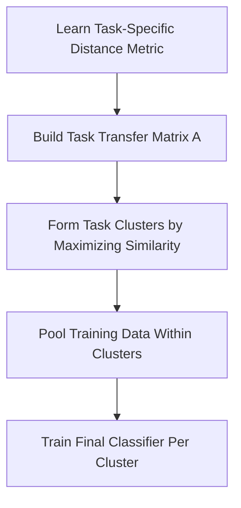
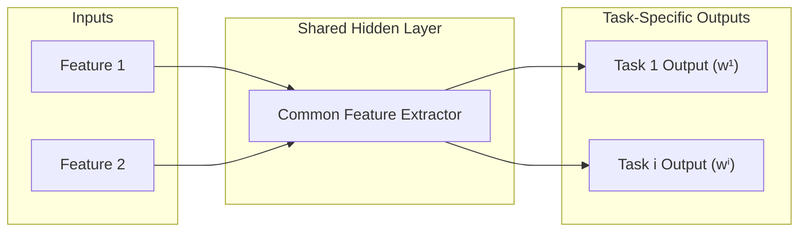
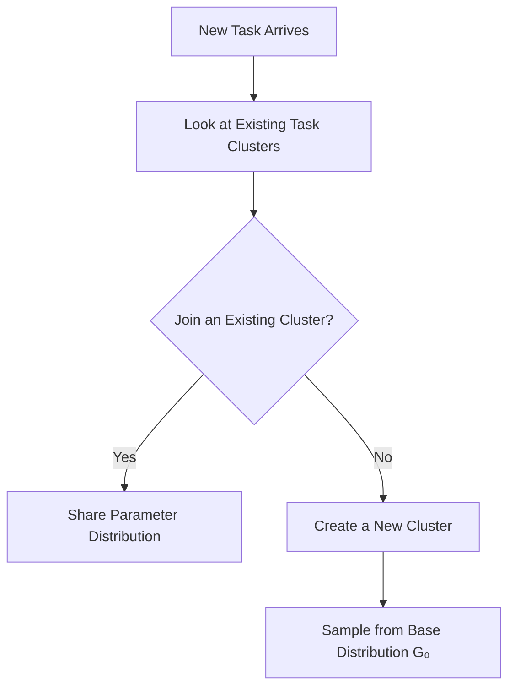
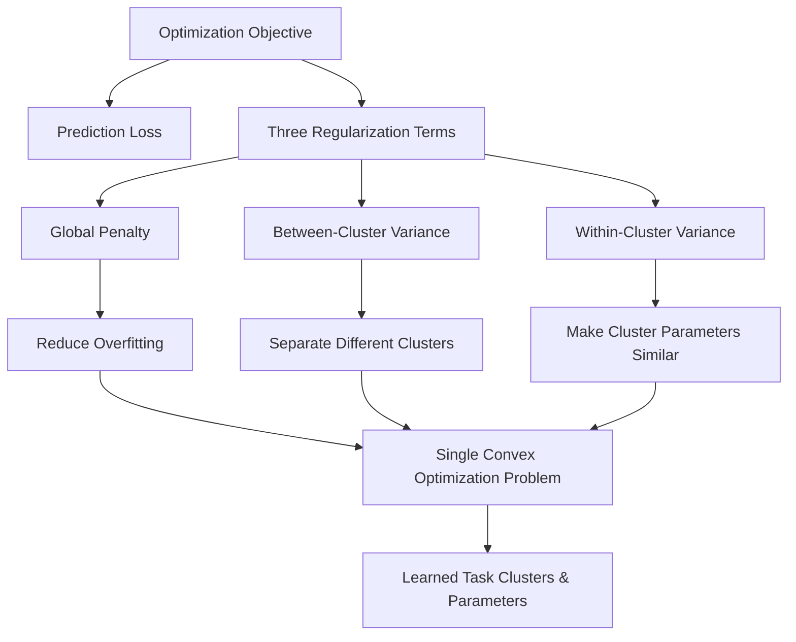
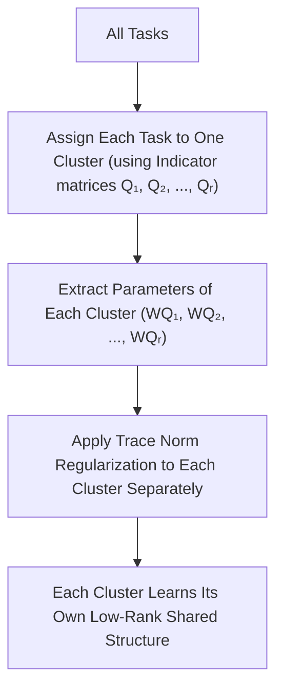
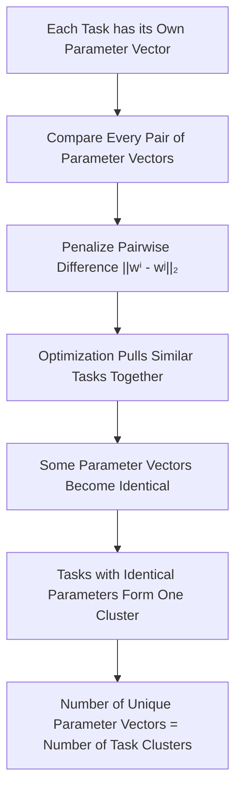
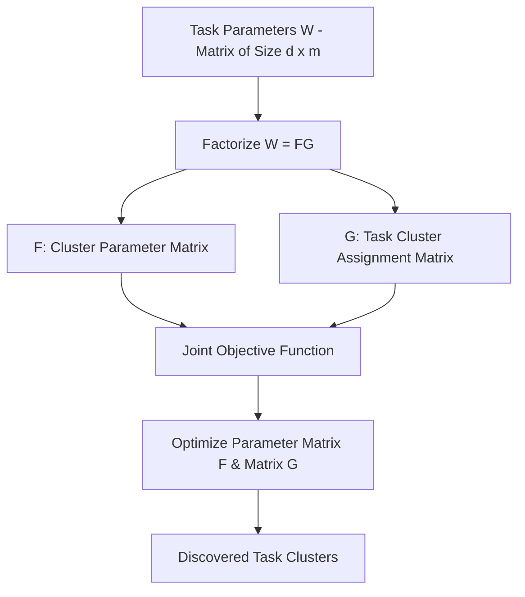
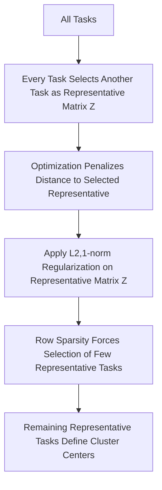
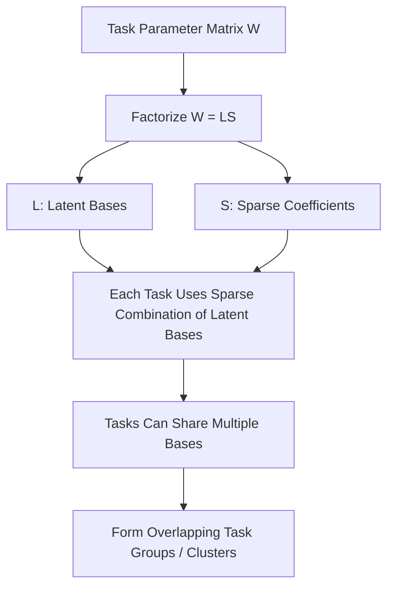

# Task Clustering Approaches in Multi-Task Learning (MTL)

---

## Slide 1: Task Clustering Approach

### Slide Content

#### Key Idea
* Assumes that related tasks naturally form clusters.
* Only tasks within the same cluster share knowledge.
* Reduces negative transfer between unrelated tasks.
* Extends traditional clustering from data points to learning tasks.

#### Why Task Clustering?
* Captures different levels of task relatedness.
* Prevents unrelated tasks from sharing parameters.
* Produces interpretable task groups.

### Visual Diagram (Mermaid)

### Transcript
Unlike previous MTL approaches that assume every task shares the same knowledge, the Task Clustering Approach assumes that tasks naturally form groups based on their similarity.

The main idea is that only tasks within the same cluster should share information, while unrelated tasks remain separate. This reduces negative transfer and improves learning.

We can think of this as extending traditional clustering algorithms. In traditional clustering, we group data samples. Here, we group entire learning tasks.

Most methods in this section differ only in how they discover these task clusters. Some use similarity matrices, some use Bayesian models, others use optimization or matrix factorization.

---

## Slide 2: First Task Clustering Algorithm

### Slide Content

#### Step 1: Learn Task-Specific Distance Metric
* Weighted Euclidean Distance:
  $$d(x, y) = \sqrt{\sum_{k=1}^d w_k (x_k - y_k)^2}$$
  * Minimizing within-class distance
  * Maximizing between-class distance

#### Step 2: Build Task Transfer Matrix
* $A = [a_{ij}]$
  * $a_{ij}$ = Generalization accuracy of Task $T_i$ using Task $T_j$'s distance metric.
  * Higher $a_{ij} 
ightarrow$ stronger task similarity.

#### Step 3: Form Task Clusters
* Objective: Maximize average similarity within each cluster:
  $$\sum_{c=1}^r rac{1}{|C_c|} \sum_{i, j \in C_c} a_{ij}$$
  * Where $C_c$ = task cluster, $|C_c|$ = number of tasks in cluster $c$.

#### Step 4: Pool Training Data
* Pool the training data of tasks within each cluster.
* Train one final weighted nearest neighbor classifier for each cluster.

#### Key Idea Box
* Learn a weighted nearest neighbor classifier for each task.
* Measure task similarity using cross-task generalization performance.
* Cluster similar tasks.
* Pool data within each cluster to train the final classifier.

### Visual Diagram (Mermaid)

### Transcript
This is the first Task Clustering method.
The main idea is that instead of forcing all tasks to share knowledge equally, the algorithm first discovers which tasks are actually similar.

First, a weighted nearest neighbor classifier is trained for every task independently. Unlike the standard Euclidean distance, a weighted Euclidean distance is used. So, each feature has its own importance. These weights are learned by minimizing the distance between samples of the same class and maximizing the distance between samples of different classes.

After learning these task-specific distance metrics, the algorithm builds the task transfer matrix A.
So, each element $a_{ij}$ measures the generalization accuracy of Task $T_i$ when using the distance metric learned from Task $T_j$. If the accuracy is high, the two tasks are considered similar.

Next, the algorithm groups tasks into clusters by maximizing the average similarity within each cluster.

Finally, after identifying the clusters, the training data of tasks within the same cluster are pooled together, and one final weighted nearest neighbor classifier is trained for each cluster.

---

## Slide 3: Multi-Task Bayesian Neural Network

### Slide Content

#### Main Idea
* Shared hidden representation for all tasks.
* Task-specific output weights.
* Task clusters are modeled using a **Mixture of Gaussian Priors**.

#### Network Architecture
* **Input Layer** $
ightarrow$ **Shared Hidden Layer** (Common Feature Extractor) $
ightarrow$ **Task-specific Output Layers**

#### Bayesian Formulation
* $w^i \sim \sum_{j=1}^r \pi_j \mathcal{N}(m_j, \Sigma_j)$
  * $w^i$: Output Weights of Task $i$
  * $r$: Number of task clusters
  * $\pi_j$: Prior probability of Cluster $j$
  * $m_j$: Mean of Cluster $j$
  * $\Sigma_j$: Covariance of Cluster $j$

#### Key Concept
* Instead of *All Tasks $
ightarrow$ One Gaussian Prior*
* Use **Multiple Gaussian Priors** $
ightarrow$ Each Gaussian represents one Task Cluster.

#### Special Case
* If $r = 1$, all tasks share one Gaussian prior (Equivalent to earlier Bayesian MTL models).

### Visual Diagram (Mermaid)

### Transcript
The second Task Clustering method introduces a Bayesian Neural Network for multi-task learning.

Unlike a standard neural network, where each weight is learned as a fixed value, a Bayesian neural network models each weight using a probability distribution. This allows the model to represent uncertainty in the parameters.

In this architecture, the input-to-hidden weights are shared across all tasks. That means every task uses the same feature extractor. 

But, the hidden-to-output weights are task-specific because each task predicts a different output. The main contribution of this method is assigning "a mixture of Gaussian priors" to the task-specific output weights.

Here, each Gaussian distribution corresponds to one task cluster. The parameter $w^i$ represents the output weights of Task $i$, while each Gaussian has its own mean and covariance. The coefficient $\pi_j$ represents the prior probability that a task belongs to Cluster $j$.

As a result, tasks assigned to the same Gaussian prior are encouraged to learn similar output-layer parameters. And it is forming a task cluster.

Finally, if the number of clusters $r$ is set to one, all tasks share the same Gaussian prior, and the method reduces to earlier Bayesian multi-task learning models.

---

## Slide 4: Dirichlet Process for Task Clustering

### Slide Content

#### Key Idea
* Automatically determines the number of task clusters.
* No need to predefine the number of clusters.
* A task either joins an existing cluster or forms a new one.

#### Bayesian Formulation
* $w^i \sim G_i, \quad G \sim DP(lpha, G_0)$
  * $w^i$: Task parameters
  * $G_0$: Base distribution
  * $lpha$: Controls new cluster creation

#### Clustering Mechanism
* $P(w^i \mid W^{-i}, lpha, G_0) = rac{lpha}{m - 1 + lpha} G_0 + rac{1}{m - 1 + lpha} \sum_{j=1}^c \delta_{w_j}$
  * Probability of creating a new cluster: $rac{lpha}{m - 1 + lpha}$
  * Probability of joining an existing cluster: $rac{1}{m - 1 + lpha}$

### Visual Diagram (Mermaid)

### Transcript
Another method is the Dirichlet Process for task clustering.

The main contribution is that the model automatically determines the number of task clusters, so unlike previous approaches, we do not need to specify the number of clusters in advance.

The first equation shows that the task parameters are generated from a distribution $G$ and it is sampled from a Dirichlet Process. The parameter $lpha$ controls how easily new task clusters are created. $G_0$ is the base distribution used whenever a completely new cluster is formed.

After integrating out the distribution $G$, we obtain the conditional distribution shown in the second equation. This equation reveals the clustering mechanism.

A new task has only two possibilities. It can either join one of the existing task clusters by reusing another task's parameters, or it can create a completely new cluster by sampling new parameters from the base distribution $G_0$.

The parameter $lpha$ controls this decision. When $lpha$ is small, the model prefers joining existing clusters, resulting in fewer large clusters. When $lpha$ is large, the probability of creating a new cluster increases, resulting in many smaller clusters.

---

## Slide 5: Task Clustering via Regularized Optimization

### Slide Content

#### Key Idea
* Instead of using Bayesian models (Gaussian Mixtures or Dirichlet Processes),
* Learn task clusters by solving one convex optimization problem with three regularization terms.

#### Objective Function
* Subject to $ar{W} = W \Pi, \quad lpha I \le \Sigma \le eta I, \quad 	ext{tr}(\Sigma) = \gamma$
  * $W$: Task parameter matrix
  * $\Pi$: Centering matrix (removes global mean)
  * $\Sigma$: Learns the cluster structure

### Visual Diagram (Mermaid)

### Transcript
Unlike the previous Bayesian approaches, here they formulate task clustering as a regularized optimization problem.

Instead of assigning probability distributions to tasks, they design an objective function whose solution naturally reveals the task clusters.

The optimization consists of three regularization objectives.

The first is the global penalty, which keeps the task parameters small and helps reduce overfitting. The second measures between-cluster variance. This encourages different task clusters to remain well separated. The third measures within-cluster variance, encouraging tasks inside the same cluster to learn similar parameters.

These three objectives are optimized together with the prediction loss in a single convex optimization problem. In the formulation, $W$ is the task parameter matrix, the centering matrix $\Pi$ removes the global mean of the task parameters, and the matrix $\Sigma$ represents the learned cluster structure.

By solving this optimization problem, the model simultaneously learns both the task parameters and the task clusters.

---

## Slide 6: Extension of MTFL to Multiple Task Clusters

### Slide Content

#### Key Idea
* Extends the original MTFL (Multi-Task Feature Learning).
* Instead of learning one shared low-rank structure, tasks are divided into multiple clusters.
* Each cluster learns its own low-rank shared representation.

#### Cluster Indicator Matrix
* $Q_i \in \{0, 1\}^{m 	imes m}$
  * $Q_i = 1 
ightarrow$ Task $T_j$ belongs to Cluster $i$
  * $Q_i = 0 
ightarrow$ Otherwise
* $\sum_{i=1}^r Q_i = I$

#### Objective Function
$$\min_{W, b, \{Q_i\}} L(W, b) + \lambda \sum_{i=1}^r \|W Q_i\|_{S(1)}^2$$
* $L(W, b)$: Training loss
* $\|W Q_i\|_{S(1)}^2$: Parameter matrix of Cluster $i$ (Trace Norm)

### Visual Diagram (Mermaid)

### Transcript
This extends the original Multi-Task Feature Learning method to support multiple task clusters. The original MTFL assumes that all tasks share a single low-rank structure. 

However, this assumption is often unrealistic because different groups of tasks may have different shared representations. This method introduces a cluster indicator matrix $Q_i$, which specifies whether a task belongs to a particular cluster. 

Since each task belongs to exactly one cluster, the sum of all indicator matrices equals the identity matrix. The objective function consists of the prediction loss together with a trace norm regularization applied separately to each cluster. 

Instead of applying one trace norm to the entire task parameter matrix, the trace norm is applied to the parameter matrix of each cluster, represented by $W Q_i$.

As a result, every cluster learns its own low-rank shared representation, which allows different groups of related tasks to learn different latent structures.

Finally, when the number of clusters $r$ equals one, the formulation reduces to the original MTFL method.

---

## Slide 7: Structurally Sparse Regularizer

### Slide Content

#### Key Idea
* No explicit cluster assignment.
* Compare every pair of task parameter vectors.
* Encourage similar task parameters to become identical.
* Tasks with identical parameter vectors form one cluster.

#### Objective Function
$$\min_{W, b} L(W, b) + \lambda \sum_{i < j} \|w^i - w^j\|_2$$
* $L(W, b)$: Prediction loss
* $\|w^i - w^j\|_2$: Parameter vector difference between Task $i$ and Task $j$

#### Effect of the Regularizer
* $\sum_{i < j} \|w^i - w^j\|_2$:
  * Similar task parameters $
ightarrow$ Identical
  * Identical parameters $
ightarrow$ Same task cluster

### Visual Diagram (Mermaid)

### Transcript
Here, this method shows a different way of discovering task clusters. Unlike previous methods, they do not introduce cluster assignment variables or probabilistic models.

Instead, they compare the parameter vectors of every pair of tasks. The objective function consists of the prediction loss together with a structurally sparse regularization term that penalizes the Euclidean distance between task parameter vectors.

During optimization, similar tasks are gradually pulled closer together. Eventually, some parameter vectors become exactly identical. Tasks whose parameter vectors become identical are considered to belong to the same cluster.

This means that the cluster structure is not explicitly defined—it naturally emerges from the optimization process.

An important advantage of this method is that it automatically determines the number of task clusters. After optimization, the number of distinct parameter vectors is exactly the number of learned clusters.

---

## Slide 8: Matrix Factorization for Task Clustering

### Slide Content

#### Key Idea
* Instead of learning the task parameter matrix $W$ directly:
  $$W = FG$$
  * $F \in \mathbb{R}^{d 	imes r}$: One parameter vector for each cluster
  * $G \in \{0, 1\}^{r 	imes m}$: Indicates which cluster each task belongs to

#### Objective Function
$$\min_{F, G, b} L(FG, b) + \lambda \|F\|_F^2$$
* Subject to $\|g^j\|_2 = 1, \quad G \in \{0, 1\}^{r 	imes m}$

#### Meaning of the Constraints
* Each column of $G$ represents one task.
* Exactly one element in each column is 1.
* Therefore, each task belongs to exactly one cluster.

### Visual Diagram (Mermaid)

### Transcript
The paper next proposes a matrix factorization view of task clustering. Instead of directly learning the task parameter matrix $W$, they decompose it into two matrices: $F$ and $G$.

The matrix $F$ stores one parameter vector for each task cluster, and the matrix $G$ specifies which cluster each task belongs to. The optimization objective learns both matrices simultaneously. The prediction loss is computed using the reconstructed task parameter matrix $FG$, while the Frobenius norm regularizes the cluster parameter matrix $F$.

The constraints on $G$ ensure that every column contains exactly one non-zero entry. Since each column corresponds to one task, this guarantees that every task belongs to exactly one cluster.

Compared with previous methods, this approach no longer learns an independent parameter vector for every task. Instead, it learns a smaller set of shared cluster parameter vectors and an assignment matrix that maps tasks to clusters.

---

## Slide 9: Representative Task Selection

### Slide Content

#### Key Idea
* Cluster centers are existing tasks, not newly learned parameter vectors.
* Each task selects another task as its representative.
* Tasks selecting the same representative naturally form a cluster.

#### Objective Function
$$\min_{W, b, Z} L(W, b) + \lambda_1 \|W\|_F^2 + \lambda_2 \sum_{i=1}^m \sum_{j=1}^m z_{ij} \|w^i - w^j\|_2^2 + \lambda_3 \|Z\|_{2,1}$$
* s.t. $Z \ge 0, \quad Z^T \mathbf{1} = \mathbf{1}$
* $\sum \sum z_{ij} \|w^i - w^j\|_2^2$: Similarity Regularizer
* $\|Z\|_{2,1}$: Representative Selection (Row Sparsity)

#### Representative Selection
* Removes unnecessary representative tasks.
* Produces row sparsity.
* Keeps only a few representative tasks.

### Visual Diagram (Mermaid)

### Transcript
Here introduce a different perspective on task clustering. Instead of learning artificial cluster centers, they use a small number of existing tasks as representative tasks.

Each task assigns a probability to every other task indicating how suitable it is as a representative. These probabilities are stored in the matrix $Z$, where $z_{ij}$ represents the probability that Task $j$ selects Task $i$ as its representative.

The objective function contains two important regularization terms. The first encourages tasks to learn similar parameter vectors when the representative selection probability between them is high. Therefore, tasks that select the same representative naturally become similar.

The second regularization term applies the $\ell_{2,1}$-norm to the matrix $Z$. This produces row sparsity. So, only a small number of representative tasks remain.

Finally, those remaining representative tasks define the task clusters.

---

## Slide 10: GO-MTL (Grouping and Overlap for MTL)

### Slide Content

#### Key Idea
* Previous task clustering methods assume one task $
ightarrow$ one cluster.
* GO-MTL removes this restriction.
* Each task is represented as a combination of multiple latent bases.
* Therefore, a task can belong to multiple clusters.

#### Matrix Factorization
$$W = LS$$
* $L \in \mathbb{R}^{d 	imes r}$: Shared latent basis vectors
* $S \in \mathbb{R}^{r 	imes m}$: Sparse coefficients for each task

#### Objective Function
$$\min_{L, S, b} L(LS, b) + \lambda_1 \|S\|_1 + \lambda_2 \|L\|_F^2$$
* $L(LS, b)$: Prediction Loss
* $\|S\|_1$: Encourages Sparse Coefficients
* $\|L\|_F^2$: Regularizes Latent Bases

### Visual Diagram (Mermaid)

### Transcript
Grouping and Overlap for Multi-Task Learning, addresses one of the main limitations of previous task clustering methods.

Earlier approaches assumed that every task belongs to exactly one cluster. GO-MTL removes this assumption by allowing tasks to share multiple latent bases. It means a task can effectively belong to multiple clusters.

Instead of directly learning the task parameter matrix $W$, the model factorizes it into two matrices: $L$ and $S$. The matrix $L$ contains a set of shared latent basis vectors. The matrix $S$ contains sparse coefficients describing how each task combines those latent bases.

The objective function includes three terms. The prediction loss fits the training data, the $\ell_1$-norm encourages sparsity in the coefficient matrix $S$, and the Frobenius norm regularizes the latent basis matrix $L$.

Because of the sparsity constraint, each task uses only a few latent bases instead of all of them. Since different tasks can share different subsets of these bases, they naturally belong to multiple overlapping task groups.
