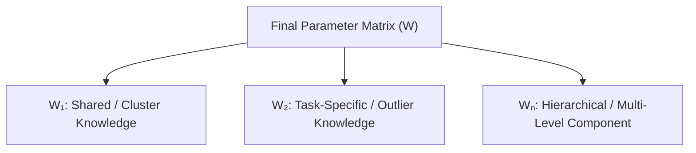
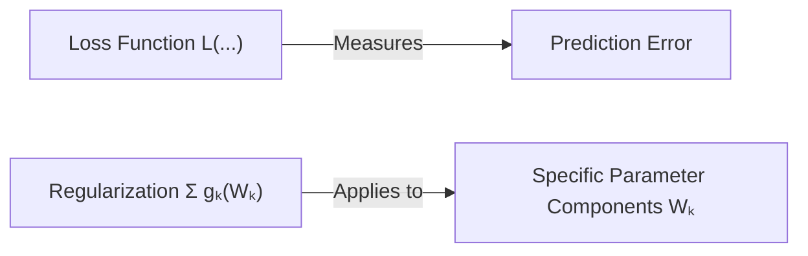
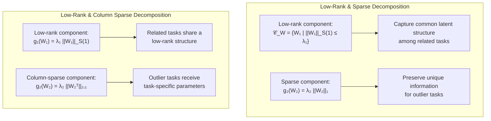
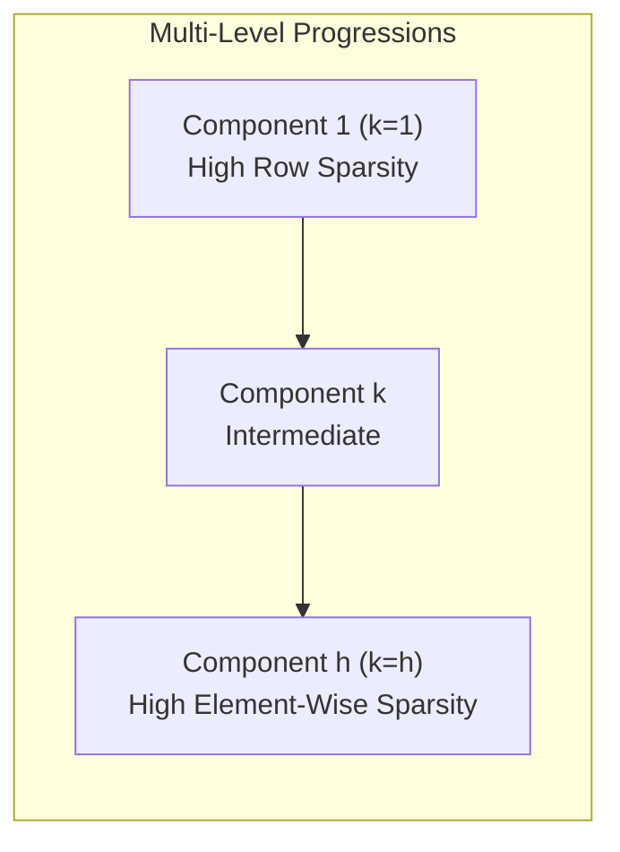
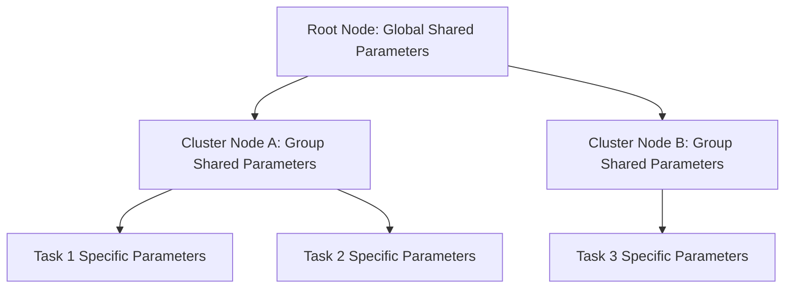

# Decomposition Method for Multi-Task Learning (MTL)

---

## Slide 1: Decomposition Approach

### Slide Content

#### What is the Decomposition Approach?
* **Earlier Multi-Task Learning (MTL) approaches:** Represent all tasks using one parameter matrix ($W$). However, a single-parameter matrix cannot effectively capture both shared and task-specific knowledge.
* **The Decomposition Approach:** Solves this by splitting the parameter matrix into multiple components.

#### Parameter Decomposition Visualization

#### Core Equation
$$W = W_1 + W_2 + \dots + W_n$$

* $W$: Final parameter matrix
* $W_1, W_2, \dots, W_n$: Different parameter components learning specific types of knowledge:
  * Shared knowledge among tasks
  * Task-specific knowledge
  * Hierarchical knowledge

---

### Slide Transcript
In the previous MTL approaches like Feature Learning, and Low-Rank Learning, a single parameter matrix was used to represent all tasks. This works well when tasks have simple relationships, but in real-world tasks are usually much more complex.

The Decomposition Approach addresses this problem by decomposing the parameter matrix into multiple components. Each component is responsible for learning a different type of knowledge.

The core equation of this approach is shown here: $W$ equals $W_1 + W_2 + \dots + W_n$, where $W$ is the final model and each component matrix captures a specific aspect of the tasks.

This makes the decomposition approach much more flexible than previous MTL methods.

---

## Slide 2: General Optimization Framework

### Slide Content

#### Mathematical Formulation
$$\min_{\{ \mathbf{W}_k \} \in \mathcal{C}_W, \mathbf{b}} L\left( \sum_{k=1}^h \mathbf{W}_k, \mathbf{b} 
ight) + \sum_{k=1}^h g_k(\mathbf{W}_k)$$

* **Loss Function:** $L\left( \sum_{k=1}^h \mathbf{W}_k, \mathbf{b} 
ight)$
* **Bias Term:** $\mathbf{b}$
* **Regularization Function:** $g_k(\mathbf{W}_k)$ for component $k$

#### Objective
* Minimize prediction error using the loss function.
* Learn multiple parameter components instead of one parameter matrix.
* Apply different regularization to each component based on its purpose.

#### Key Idea
Different parameter components are designed to learn different characteristics. Therefore, each component requires its own regularization function instead of using a single regularizer for the entire model.

---

### Slide Transcript
The objective of the general optimization framework is to learn all the parameter components together while minimizing the prediction error.

The first term is the loss function. It measures how accurate the model's predictions are. During training, the model tries to minimize this error.

The second term is the sum of regularization functions. This is important because different components have different responsibilities.

By optimizing all these components together, the decomposition approach can represent much more complex task relationships than methods that use only a single parameter matrix.

---

## Slide 3: Decomposition Models – Low-Rank & Sparse Variants

### Slide Content

#### 1. Low-Rank & Sparse Decomposition
* **Low-Rank Component:** $\mathcal{C}_W = \{ \mathbf{W}_1 \mid \|\mathbf{W}_1\|_{\mathcal{S}(1)} \le \lambda_1 \}$
  * Captures common latent structure among related tasks.
* **Sparse Component:** $g_2(\mathbf{W}_2) = \lambda_2 \|\mathbf{W}_2\|_1$
  * Preserves unique information for outlier tasks.

#### 2. Low-Rank & Column Sparse Decomposition
* **Low-Rank Component:** $g_1(\mathbf{W}_1) = \lambda_1 \|\mathbf{W}_1\|_{\mathcal{S}(1)}$
  * Related tasks share a low-rank structure.
* **Column-Sparse Component:** $g_2(\mathbf{W}_2) = \lambda_2 \|\mathbf{W}_2^T\|_{2,1}$
  * Outlier tasks receive task-specific parameters.

---

### Slide Transcript
Let's move onto some decomposition models.

The first model decomposes the parameter matrix into two components. The first component is low-rank and captures the common structure shared by related tasks. The second component is sparse and stores task-specific information or outlier tasks.

The next equation further improves this idea. The shared component is still low-rank, but the second component uses column sparsity. This means that only tasks that are significantly different from the others receive task-specific parameters, while the remaining tasks rely entirely on the shared low-rank structure.

---

## Slide 4: Decomposition Models – Task Clustering & Multi-Level

### Slide Content

#### 1. Task Clustering Decomposition Model
* **Formulation:** $g_1(\mathbf{W}_1) = \lambda_1 c(\mathbf{W}_1) + \lambda_2 \|\mathbf{W}_1\|_F^2$, $g_2(\mathbf{W}_2) = \lambda_3 \|\mathbf{W}_2\|_F^2$, $\mathcal{C}_W = \emptyset$
* Decomposes the parameter matrix into $W = W_1 + W_2$.
* $W_1$ encourages similar tasks to have identical parameters, automatically forming **task clusters**.
* $W_2$ captures **task-specific differences**, improving flexibility.
* Frobenius norm regularization controls model complexity and helps prevent overfitting.

#### 2. Multi-Level Decomposition
* **Formulation:** $g_k(\mathbf{W}_k) = \lambda \left[ (h-k)\|\mathbf{W}_k\|_{2,1} + (k-1)\|\mathbf{W}_k\|_1 
ight] / (h-1)$
* Introduces multiple parameter components.
* Combines **row sparsity** ($\|\mathbf{W}_k\|_{2,1}$) and **element-wise sparsity** ($\|\mathbf{W}_k\|_1$).
* Earlier components learn **shared knowledge** while later components learn **task-specific knowledge**.
* Learns hierarchical sharing between tasks.

---

### Slide Transcript
This decomposition model divides the parameter matrix into two components: $W_1$ and $W_2$. The first component, $W_1$, encourages similar tasks to have identical parameter values, allowing task clusters to be formed automatically during training. The second component, $W_2$, captures the unique characteristics of individual tasks.

After that, Equation 4 extends the decomposition approach by introducing multiple parameter components instead of only two. This allows the model to represent task relationships at multiple levels.

---

## Slide 5: Hierarchical Decomposition

### Slide Content

#### Mathematical Formulation
$$\min_{\{\mathbf{W}_j\}, \mathbf{b}} L\left( \sum_{k=1}^h \mathbf{W}_k, \mathbf{b} 
ight) + \left( \sum_{v \in \mathcal{V}} \lambda_v \left( \sum_{a \in \mathcal{D}(v)} r(\mathbf{W}_a)^p 
ight)^{rac{1}{p}} 
ight)^2$$

$$	ext{s.t. } \mathbf{w}_a^i = 0 \quad orall i 
otin t(a)$$

#### Tree Structure Hierarchy

#### Key Idea
* Organizes tasks into a **hierarchical tree structure**.
* Each node in the hierarchy has its own parameter matrix.
* A task is represented by **combining parameters from all ancestor nodes**.
* Enables tasks to share knowledge at different hierarchy levels.

#### Advantages
* Captures hierarchical relationships among tasks.
* Shares common knowledge while preserving task-specific information.

---

### Slide Transcript
The final equation introduces the most advanced decomposition model in this section, called hierarchical decomposition.

Unlike the previous models, which only separate shared and task-specific knowledge, this approach assumes that tasks are organized in a hierarchy.

Each node in the hierarchy has its own parameter matrix. The final model for a task is obtained by combining the parameter matrices from all ancestor nodes.

This allows the model to share general knowledge at higher levels while learning more specific knowledge at lower levels.
