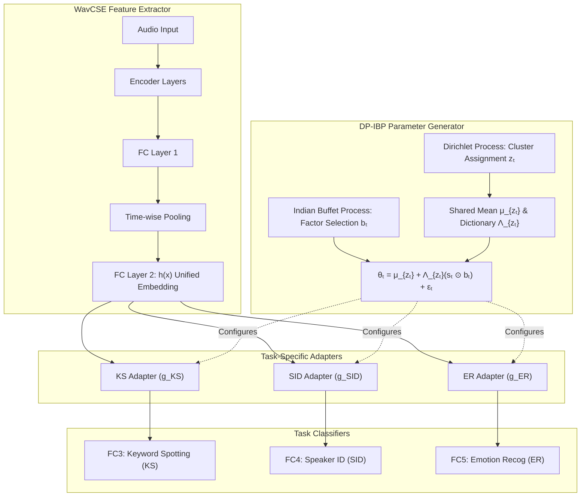
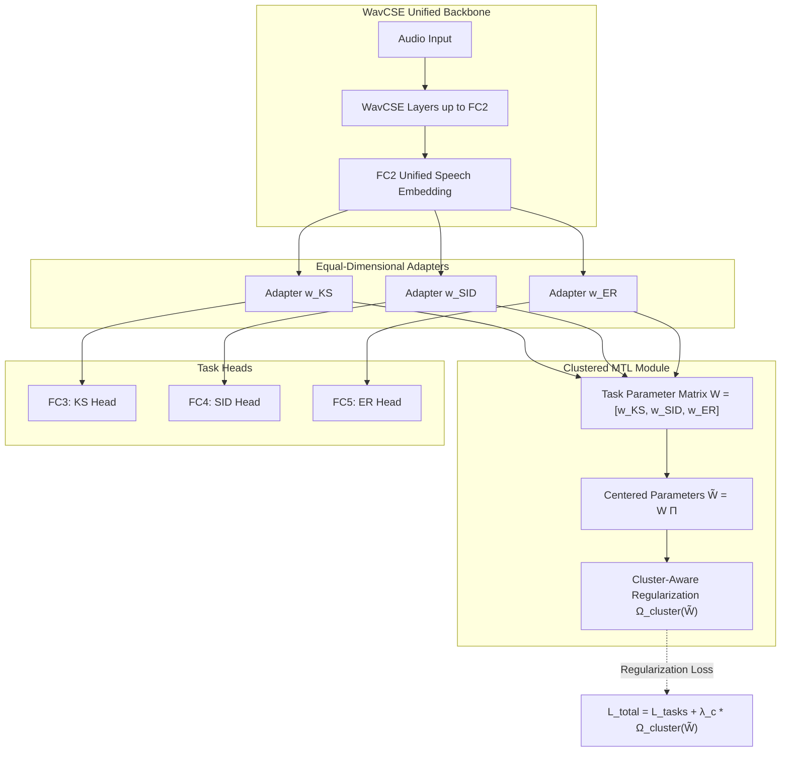
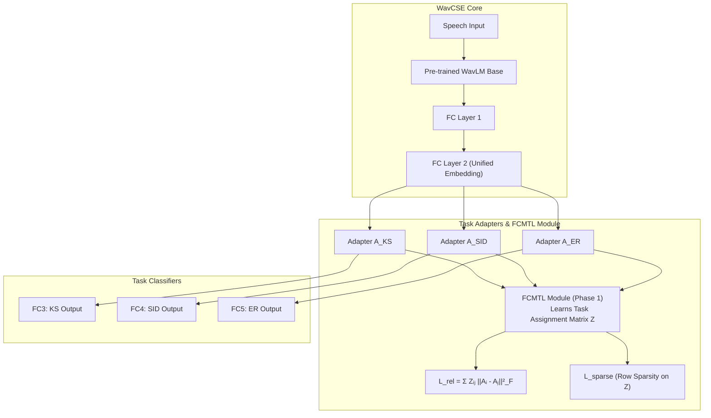
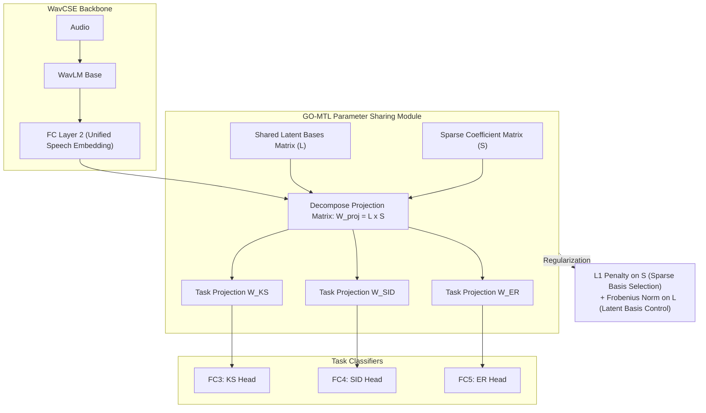

# Flexible Modeling of Latent Task Structures in Multitask Learning

---

## Slide 1: DP-IBP Cluster-Structured Task Adapters

### Slide Content

#### Approach
* The Dirichlet Process (DP) learns the cluster assignment $z_t$ of each task.
* Tasks in the same cluster share a mean $\mu_{z_t}$ and factor dictionary $\Lambda_{z_t}$.
* The Indian Buffet Process (IBP) factor selection $b_t$ lets each task use only the relevant factors:
  $$	heta_t = \mu_{z_t} + \Lambda_{z_t} (s_t \odot b_t) + \epsilon_t$$
* Generated $	heta_t$ configures adapter $g_t$, transforms $h(x)$ before classification.

#### Integration into WavCSE
* Retains WavCSE up to FC2, which generates the unified speech embedding $h(x)$.
* Adds same-dimensional task adapters before the KS, SID, and ER classification heads.
* A DP-IBP parameter generator constructs each adapter's parameters—FC3-FC5 remain task-specific classifiers.

#### Why Use It?
* Provides two-level sharing: between clustered tasks and through selected factors inside each cluster.
* Equal-sized adapters solve the different output-dimension problem of FCs.

#### Expected Outcome
* Related tasks reuse common parameter patterns, preserving task-specific behavior.

#### Loss Formulation
$$\mathcal{L}_{total} = rac{\mathcal{L}_{KS} + \mathcal{L}_{SID} + \mathcal{L}_{ER}}{3} + \lambda_s \mathcal{L}_{sparse} + \lambda_r \mathcal{L}_{residue}$$
* Cross-entropy is used for each classification task.
* Additional terms encourage sparse factor usage and small task-specific deviations.

### Visual Diagram (Mermaid)

### Transcript
This architecture adapts the DP-IBP mixture-of-factor-analysers method to WavCSE. The original WavCSE architecture is retained up to Fully Connected 2, which generates the unified speech embedding. The modification begins after this embedding.

Instead of passing the embedding directly to the three classification heads, it adds a same-dimensional adapter for each task for 3 tasks. These adapters are necessary because the original FC3, FC4 and FC5 layers have different output dimensions due to their different numbers of classes. Therefore, their parameters cannot be clustered directly in a consistent way.

The adapter parameters are generated using the task-clustering model. First, the Dirichlet Process determines the cluster assignment of each task. Tasks assigned to the same cluster share a cluster mean and a factor dictionary. Within that cluster, the Indian Buffet Process selects which latent factors are relevant to each task.

The factor-strength vector controls how strongly the selected factors contribute, and the residual term preserves task-specific behaviour.

The generated parameter vector, $	heta$, configures the corresponding adapter. It is important that the embedding does not pass through the DP module. The embedding is the adapter's input, and the clustering module generates the adapter's weights.

This provides two levels of sharing: tasks can share cluster-level parameters, and still select different factors within the cluster.

Therefore, the model does not force KS, SID and ER to share equally. The expected outcome is reduced negative transfer, and better use of genuine task relationships.

Training uses the combined cross-entropy losses of the three tasks, with additional regularization to encourage sparse factor selection and control task-specific residuals.

---

## Slide 2: Clustered Multi-Task Learning

### Slide Content

#### Approach
* Parameter-based MTL that learns task relationships from adapter params.
* Apply Cluster Norm to centered parameters:
  $$	ilde{W} = W \Pi$$
  while optimizing the relaxed cluster structure $\Sigma_c$.
* Related tasks are encouraged to have similar parameter structures.

#### Integration into WavCSE
* Added equal-dimensional task adapters after FC2 and before the KS, SID, and ER classifiers.
* Adapter parameters form the task matrix $W = [w_{KS}, w_{SID}, w_{ER}]$ for cluster-aware regularization during training.

#### Why Use It?
* Avoids assuming all speech tasks are equally related ($\epsilon_W > \epsilon_B > \epsilon_M$).
* Keeps related tasks closer within clusters while allowing distinct task groups to remain separated.

#### Expected Outcome
* Discover relationships among linguistic and paralinguistic tasks.
* Potentially improve the generalizability of the unified FC2 embedding.

#### Loss Formulation
$$\mathcal{L}_{total} = \mathcal{L}_{KS} + \mathcal{L}_{SID} + \mathcal{L}_{ER} + \lambda_c \Omega_{cluster}(	ilde{W})$$
* $\lambda_c$: Cluster regularization strength
* $\Omega_{cluster}(	ilde{W})$: Cluster norm regularizer on centered task parameter matrix $	ilde{W}$.
* Controls cluster-aware regularization of task-adapter parameters.

### Visual Diagram (Mermaid)

### Transcript
This modification introduces a clustered multi-task learning approach into the original WavCSE architecture, based on the parameter-based MTL concept proposed by Jacob.

In the proposed modification, it introduces three equal-dimensional task adapters after FC2, one for keyword spotting, one for speaker identification, and one for emotion recognition. The original task classifiers are then placed after these adapters. The adapters provide task-specific transformations while keeping FC2 as the unified speech embedding.

During training, the parameters of these adapters are vectorized to form the task parameter matrix $W$. Following the clustered MTL approach, this matrix is centered, and a cluster-norm regularizer is applied while optimizing a relaxed cluster structure.

The main idea is that if some tasks are related, their task-specific parameters are encouraged to have similar structures, while dissimilar tasks are allowed to remain more distinct. Therefore, the task relationships do not need to be manually predefined.

The total training objective combines the original KS, SID, and ER task losses with the additional cluster regularization term. This allows normal task learning and task-relationship learning to happen together.

The main reason for using this approach is to avoid assuming that KS, SID, and ER are equally related. By learning these relationships from the task parameters, the model may reduce negative transfer.

The expected outcome is a better balance between shared and task-specific knowledge, potentially producing a more generalizable FC2 unified speech embedding for unseen downstream speech tasks.

---

## Slide 3: Flexible Clustered Multi-Task Learning by Learning Representative Tasks

### Slide Content

#### Approach
* Learn an assignment matrix $Z$ to capture task relationships.
* Allow soft/overlapping task clusters instead of fixed clusters.
* Encourage related task adapters to learn similar parameters.

#### Integration into WavCSE
* Add equal-dimensional task-specific adapters ($A_{KS}, A_{SID}, A_{ER}$) between the unified embedding and each task classifier.
* Apply the FCMTL relationship module only during joint Phase-1 training.

#### Why Use It?
* Learns task relationships directly from data.
* Enables sharing across multiple representative tasks.

#### Expected Outcome
* Better balance of shared and task-specific knowledge.
* Potentially improve WavCSE performance and generalization.

#### Loss Formulation
$$\mathcal{L}_{total} = \mathcal{L}_{KS} + \mathcal{L}_{SID} + \mathcal{L}_{ER} + \lambda_r \mathcal{L}_{rel} + \lambda_s \mathcal{L}_{sparse}$$
* $\mathcal{L}_{rel} = \sum_{i, j} Z_{ij} \|A_i - A_j\|_F^2$: Encourages related task adapters to learn similar parameters.
* $\mathcal{L}_{sparse}$: Improves selection of a limited set of representative tasks ($Z$).

### Visual Diagram (Mermaid)

### Transcript
This modification introduces Flexible Clustered Multi-Task Learning, or FCMTL, into the WavCSE architecture.

In the original WavCSE model, 3 tasks jointly optimize a common unified embedding. However, this approach does not explicitly model how strongly these three tasks are related to each other.

Here it keeps the original WavCSE architecture unchanged up to FC2, and then introduces three equal-dimensional task-specific adapters after Fully Connected Layer 2: one each for tasks.

The key addition is the FCMTL relationship module. During training, it learns an assignment matrix, $Z$, based on the task-adapter parameters. This matrix represents how strongly each task selects other tasks as representative tasks.

Here an important advantage is that this provides flexible or soft task clustering. Instead of assigning a task to only one fixed cluster, a task can be related to multiple representative tasks with different strengths. Therefore, the model can learn the relationships among KS, SID, and ER directly from the data.

The FCMTL regularization loss encourages strongly related task adapters to learn similar parameters, and the sparsity component limits the number of important representative tasks. This may help reduce negative transfer when some tasks are less related.

The expected outcome is a unified speech embedding that is still shared across all three tasks but is trained under a more structured, relationship-aware multi-task learning objective. So this allows us to evaluate whether flexible task clustering can improve task performance as well as the generalization ability of the WavCSE embedding compared with the original feature-based MTL approach.

---

## Slide 4: Learning Task Grouping and Overlap in Multi-Task Learning

### Slide Content

#### Approach
* Parameter-based MTL using GO-MTL.
* Represent task projection parameters using:
  $$W_{proj} = LS$$
  * $L$: Shared latent task basis matrix.
  * $S$: Captures sparse task-specific parameters.
* Sparse coefficients allow KS, SID, and ER to have partially overlapping task relationships rather than forcing fixed task clusters.

#### Integration into WavCSE
* Keep the architecture (up to FC2) unchanged.
* Introduce a GO-MTL parameter-sharing module after the unified embedding for KS, SID, and ER.
* Learn equal-dimensional task-specific projection parameters as $W_{proj} = LS$, followed by the task-specific classifiers (FC3-FC5).

#### Why Use It?
* Enables selective parameter sharing between related tasks while preserving task-specific differences.
* May reduce negative transfer by limiting unnecessary sharing between less-related tasks.

#### Expected Outcome
* Potential improvement in individual task performance and the quality/generalizability of the unified embedding.
* Provides a comparison between GO-MTL parameter sharing and the original feature-based WavCSE baseline.

#### Loss Formulation
$$\mathcal{L}_{total} = \mathcal{L}_{KS} + \mathcal{L}_{SID} + \mathcal{L}_{ER} + \mu \|S\|_1 + \lambda \|L\|_F^2$$
* $\|S\|_1$: Encourages sparse task-basis selection.
* $\|L\|_F^2$: Regularizes the shared latent bases.

### Visual Diagram (Mermaid)

### Transcript
This modification introduces GO-MTL, or Grouping and Overlap Multi-Task Learning, into the original WavCSE architecture. In the original WavCSE model, the three tasks—keyword spotting, speaker identification, and emotion recognition—share the same feature-learning architecture up to FC2, which produces the unified speech embedding. After that, each task uses an independent classification head.

In this proposed modification, it keeps the entire WavCSE feature extractor and unified embedding architecture unchanged. The main modification is introduced after FC2, where it adds a GO-MTL parameter-sharing module before the final task-specific classifiers.

The core idea of GO-MTL is represented by the equation $W = L 	imes S$. Here, $L$ contains a set of shared latent task bases. $S$ contains sparse coefficients that determine which latent bases are used by each task.

So, using these, the model learns task-specific projection parameters for KS, SID, and ER.

The important advantage is that task relationships can overlap. For example, KS and SID may share one latent basis, while SID and ER may share another. Therefore, we don't need to force the tasks into completely separate or fixed clusters.

The expected benefit is more selective knowledge sharing. Related information can be shared between tasks, unnecessary sharing can be reduced, so it may help reduce negative transfer.

During training, here this retains the three task losses and introduces two GO-MTL regularization terms. The $\ell_1$ penalty on $S$ encourages sparse selection of latent bases, and the regularization on $L$ controls the complexity of the shared latent bases.
