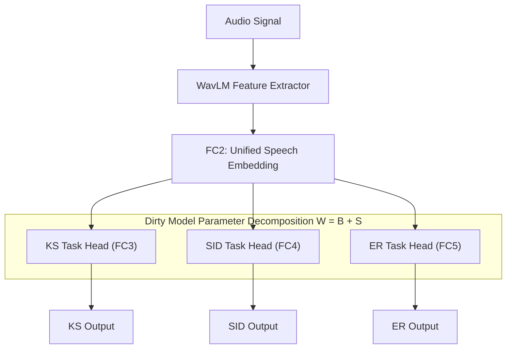
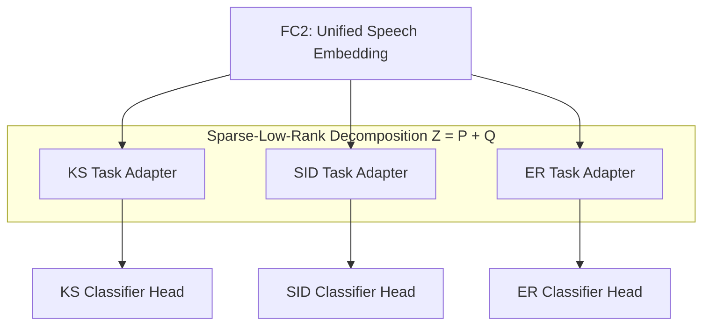
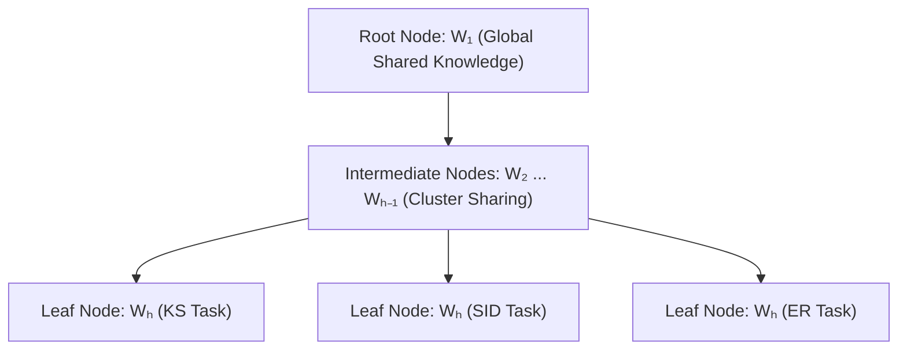

# Decomposition-Based Multi-Task Learning (MTL) Architectures

---

## Slide 1: Dirty Model - Parameter-Based MTL

### Slide Content

#### Integration into WavCSE
* Keep the **WavLM feature extractor** and **unified embedding** unchanged.
* Apply **Dirty Model parameter decomposition** to the downstream KS (Keyword Spotting), SID (Speaker Identification), and ER (Emotion Recognition) task heads (FC3–FC5).
* The embedding still flows directly to each task head; the Dirty Model controls how their parameters are jointly learned.

#### Architecture Flow

#### Approach
* Parameter-based MTL using **Dirty Model decomposition**.
* Jointly decomposes task-head parameters as:
  $$W = B + S$$
* **$B$:** Captures shared parameter patterns across tasks.
* **$S$:** Captures sparse task-specific parameters.

#### Why Use It?
* Enables flexible knowledge sharing without forcing all tasks to share the same parameters.
* Preserves task-specific information and may reduce **negative transfer** between KS, SID, and ER.

#### Expected Outcome
* Better balance between shared and task-specific knowledge.
* Potential improvement in individual task performance and overall MTL generalization.
* Provides a **direct comparison** of parameter-based MTL against the original feature-based wavCSE baseline.

---

### Slide Transcript
Now I will explain the decomposition-based multi-task learning architectures. The first approach is the Dirty Model.

The original shared feature extraction process remains unchanged. The main modification is in the downstream task-specific section. The unified embedding is still directly provided to the three task heads.

However, instead of learning the parameters of these task heads completely independently, the Dirty Model jointly learns their parameters using the decomposition $W = B + S$. Here, $B$ captures shared parameter patterns across the tasks, while $S$ captures sparse task-specific information.

The purpose is to allow useful knowledge sharing between related tasks while preserving information specific to each task. The expected outcome is to reduce negative transfer and improve individual task performance and overall multi-task generalization.

This is the easiest to implement, as it requires minimal changes to the existing WavCSE architecture compared with the more complex tree-based and hierarchical approaches.

---

## Slide 2: Sparse-Low-Rank Decomposition Approach

### Slide Content

#### Integration into WavCSE
* Integrated after **FC2 (unified embedding)** and before the final KS, SID, and ER classifiers.
* Equal-dimensional **task adapters** are jointly decomposed as $W = P + Q$, then each adapted representation is passed to its corresponding task head.

#### Architecture Flow

#### Approach
* Parameter-based MTL approach that jointly decomposes the task-adapter parameter matrix as:
  $$Z = P + Q$$
* **$P$:** Sparse component — captures task-specific information.
* **$Q$:** Low-rank component — captures shared structure across tasks.

#### Why Use It?
* Allows related speech tasks to share useful knowledge while preserving task-specific characteristics, reducing negative interference from forcing all parameters to be shared.

#### Expected Outcome
* Preserve discriminative task-specific information.
* Reduce parameter redundancy through low-rank sharing.
* Potentially improve multi-task generalization and prediction performance.

---

### Slide Transcript
Here, it is integrating a sparse-low-rank decomposition approach into the WavCSE multi-task architecture. After FC2, this embedding is passed to three task adapters.

Instead of learning the adapter parameters completely independently, their parameters are jointly structured as $W = P + Q$. Here, $P$ is the sparse component, which captures task-specific information, while $Q$ is the low-rank component, which captures shared structure across the three tasks.

This decomposition is applied at the adapter level before the final task-specific fully connected layers. The expected outcome is to enable effective knowledge sharing while preserving task-specific characteristics, potentially reducing parameter redundancy and improving the overall generalization and performance of the multi-task model.

---

## Slide 3: Hierarchical Regularization Cascade

### Slide Content

#### Integration into WavCSE
* WavCSE generates the **unified speech embedding**.
* Same-dimensional **task adapters** are added before the KS, SID, and ER classification heads.
* The cascade regularizes the adapter parameters during joint multi-task training, progressing from shared to more task-specific learning.

#### Sharing Progression Cascade

#### Approach
* A **Hierarchical Regularization Cascade** that learns related tasks with progressively decreasing levels of parameter-sharing incentive.
* Jointly learns multiple tasks through hierarchical levels:
  $$	ext{Maximum Sharing} \longrightarrow 	ext{Reduced Sharing} \longrightarrow 	ext{Task-Specific Learning}$$

#### Why Use It?
* Enables KS, SID, and ER to benefit from shared speech information while still learning task-specific patterns.
* Does not require predefined task grouping or hierarchy.

#### Expected Outcome
* Better utilization of cross-task relationships.
* Reduced negative interference between unrelated task features.
* Potentially improved generalization and performance across KS, SID, and ER.

---

### Slide Transcript
This approach integrates the Hierarchical Regularization Cascade for multi-task speech learning. The main idea is to learn the three tasks—keyword spotting, speaker identification, and emotion recognition—jointly at different levels of information sharing.

At the first level, the model strongly encourages sharing of common information across tasks. As the cascade progresses, the sharing incentive gradually decreases, allowing the model to capture more task-specific information.

In the proposed integration, WavCSE first generates a unified speech embedding, which is passed to task-specific adapters for KS, SID, and ER. The hierarchical regularization cascade is applied to these compatible adapter parameters during joint training.

This approach is expected to provide better cross-task knowledge sharing while preserving task-specific features, potentially reducing task interference and improving the overall generalization and performance of all three speech tasks.

---

## Slide 4: TAT-Based Hierarchical Parameter Sharing

### Slide Content

#### Integration into WavCSE
* The original WavCSE forward path remains unchanged.
* **TAT (TAsk Tree)** is applied to the KS, SID, and ER task parameters during joint training.
* Equal-sized task adapters can be used if the task-head dimensions differ.

#### Hierarchical Task Tree Model

#### Approach
* **TAsk Tree (TAT)** learns hierarchical relationships among multiple tasks by decomposing their parameter matrix:
  $$W = \sum_{h=1}^{H} W_h$$
* **Fusion regularization** and **sequential constraints** determine how tasks are grouped across the hierarchy.

#### Why Use It?
* Enables structured knowledge sharing between related tasks while preserving task-specific information, potentially reducing negative transfer.

#### Expected Outcome
* Automatically learns task relationships.
* Improves parameter sharing, generalization, and potentially overall multi-task performance.

---

### Slide Transcript
Finally this slide presents how the TAsk Tree, or TAT, decomposition approach can be integrated with WavCSE. TAT is a multi-task learning method that learns hierarchical relationships between tasks. It decomposes the task parameter matrix into multiple component matrices, where each component represents a different level of the hierarchy. Fusion regularization and sequential constraints are then used to control how task parameters are shared across these levels.

In WavCSE architecture, the original feature flow remains unchanged. The unified embedding is still passed to the Keyword Spotting, Speaker Identification, and Emotion Recognition branches. TAT is applied to the parameters of these task branches during joint training. If the task-head dimensions are different, equal-sized adapters can be introduced.

The expected outcome is better structured knowledge sharing between related tasks, while maintaining task-specific information, potentially improving generalization and overall multi-task performance.
