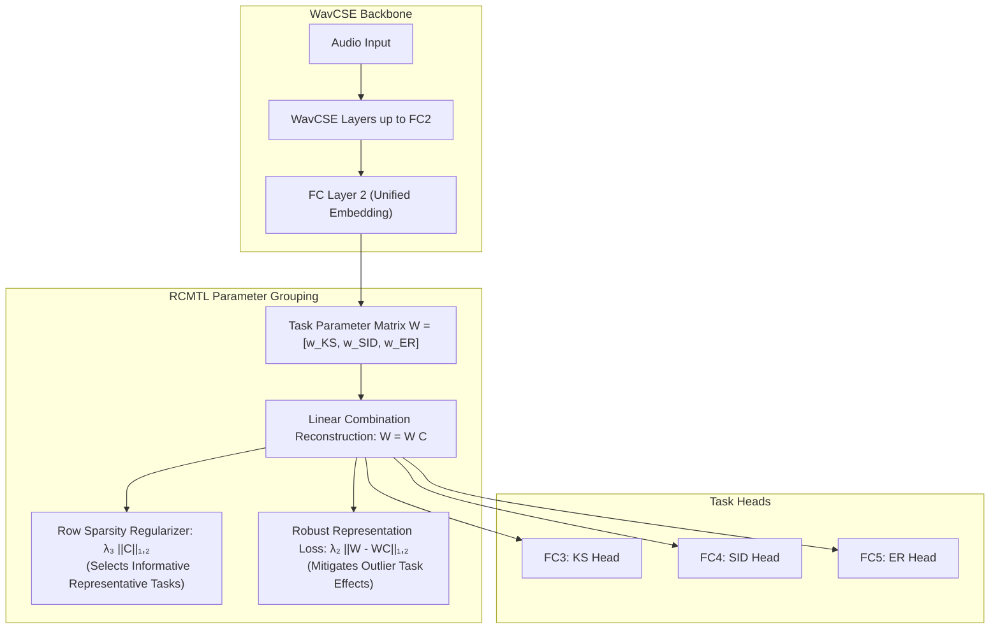
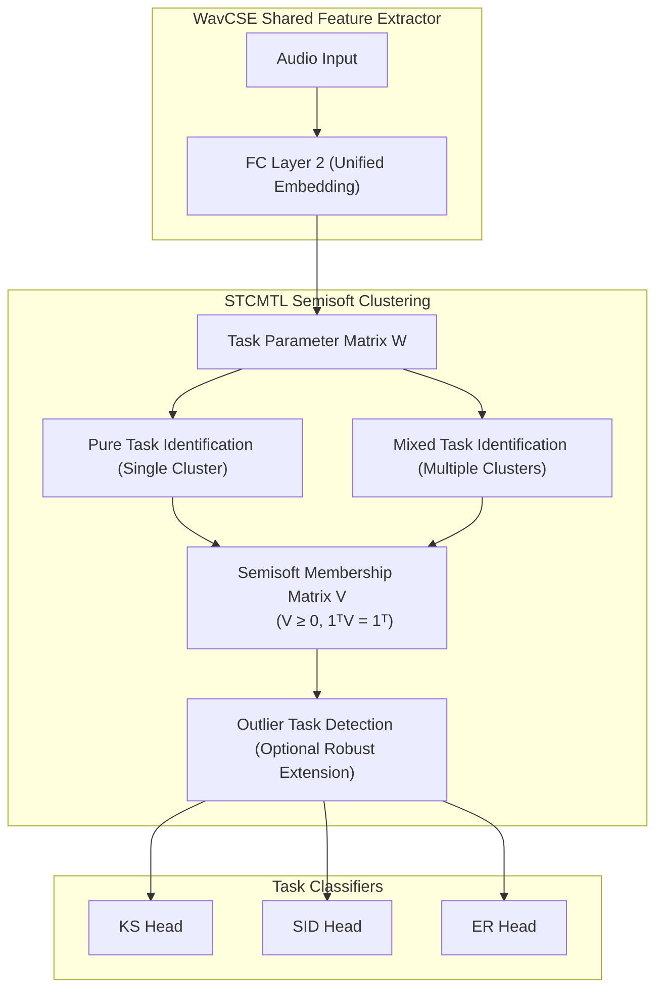
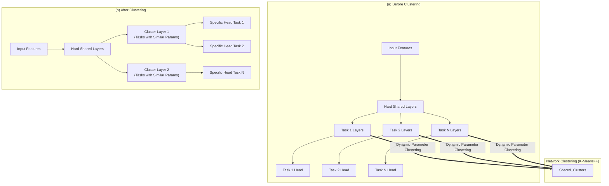

# Advanced Multi-Task Learning Approaches with Representative Tasks & Clustering

---

## Slide 1: Robust Clustered MTL with Representative Tasks (RCMTL)

### Slide Content

#### Main Idea
* **Reference:** Yao et al., *"Robust Task Grouping with Representative Tasks for Clustered Multi-Task Learning"* (2019)
* Selects a subset of representative tasks to characterize all tasks.
* Represents each task as a linear combination of representative tasks.
* Combination coefficients indicate the learned task correlations.

#### Formulation
$$\min_{W, C} \mathcal{L}(W) + \lambda_1 \|W\|_F^2 + \lambda_2 \|W - WC\|_{1,2} + \lambda_3 \|C\|_{1,2}$$
* $W$: Task parameter matrix ($W = WC$)
* $C$: Relationship matrix (combination coefficients)
* $\|C\|_{1,2}$: Selects representative tasks through row sparsity.
* $\|W - WC\|_{1,2}$: Robust representation loss (reduces the effect of outlier tasks).

#### Key Concepts
* Learns the number of task groups automatically from data.
* Allows a task to relate to multiple representative tasks.
* Does not force every task to be related to another task.
* Supports information sharing between negatively correlated tasks.

#### Adaptation to WavCSE
* Keep WavCSE unchanged up to FC2.
* Learn $C$ to reconstruct each task from its representative-task combination.
* Jointly optimize task losses and robust representative-task grouping.

### Visual Diagram (Mermaid)

### Transcript
In 2019, another approach was proposed for CMTL. That is called Robust Clustered Multi-Task Learning with Representative Tasks. The main idea is different from conventional task clustering. So here, instead of directly assigning every task to a fixed cluster, RCMTL first selects a subset of representative tasks.

Then, each task is modeled as a linear combination of these representative tasks. The combination coefficients form a relationship matrix, $C$, that indicates the correlation between tasks. A key contribution is the row-sparse $\ell_{1,2}$-norm applied to this relationship matrix. This encourages only the most informative tasks to become representatives, while allowing other tasks to share information with them to different degrees.

The method can also capture negative task correlations, so negatively correlated tasks are not automatically separated into different groups. Another important feature is robustness. RCMTL applies an $\ell_{1,2}$-based representation loss, which reduces the influence of outlier or unrelated tasks.

For WavCSE, we can keep the shared architecture unchanged up to FC2 and apply RCMTL to comparable task-specific representations of KS, SID, and ER.

This allows the model to learn which tasks should act as representatives and how strongly each task should share information with the others.

---

## Slide 2: Semisoft Task Clustering for Multi-Task Learning (STCMTL)

### Slide Content

#### Main Idea
* **Reference:** Zhang & Sun, *"Semisoft Task Clustering for Multi-Task Learning"* (2022)
* Distinguishes tasks as **pure tasks** or **mixed tasks**.
* Pure tasks belong to one cluster, mixed tasks can span multiple clusters.
* Represents mixed tasks using weighted combinations of pure-task clusters.

#### Formulation
$$\min_{U, V} \sum_{i=1}^T rac{1}{n_i} \mathcal{L}(y_i, X_i U v_i)$$
$$	ext{s.t. } \|U\|_F^2 \le a, \quad V \ge 0, \quad \mathbf{1}^T V = \mathbf{1}^T$$
* Multi-task prediction loss combined with feature sparsity/selection constraints.
* $V \ge 0, \mathbf{1}^T V = \mathbf{1}^T$: Valid task-cluster memberships.
* Can be extended to robust task clustering by detecting outlier tasks before estimating cluster memberships.

#### Key Concepts
* Uses semisoft clustering instead of strict hard clustering.
* Membership weights show how strongly a mixed task belongs to each cluster.
* Simultaneously performs task clustering and relevant feature selection.

#### Adaptation to WavCSE
* Keep WavCSE unchanged up to FC2.
* Apply STCMTL to the task-specific parameter matrix after the shared representation.
* Learn pure/mixed task memberships to control task-level information sharing.

### Visual Diagram (Mermaid)

### Transcript
The next approach is Semisoft Task Clustering for Multi-Task Learning. The main difference of this approach is that it does not assume every task belongs strictly to only one cluster. STCMTL distinguishes between pure tasks and mixed tasks.

A pure task belongs to a single cluster, while a mixed task can be related to multiple clusters. The mixed task is represented using a weighted combination of pure-task clusters, where the membership weights indicate how strongly it belongs to each cluster.

For our WavCSE adaptation, we can propose keeping the existing shared architecture up to FC2 and applying STCMTL to the task-specific parameter structure.

This allows relationships between the main 3 tasks to be learned without forcing them into completely separate or rigid groups. Another useful aspect is that the paper extends STCMTL to robust task clustering. In this extension, tasks that do not fit the learned cluster structure are identified as outlier tasks and excluded when estimating the normal task memberships. This could help prevent an unrelated or highly different task from negatively affecting the learned task groups.

Therefore, STCMTL provides flexible task relationships, selective information sharing, and a potential mechanism for handling outlier tasks.

---

## Slide 3: Network Clustering for Multi-Task Learning (NCMTL)

### Slide Content

#### Main Idea
* **Reference:** Mu et al., *"Network Clustering for Multi-task Learning"* (2025)
* Introduces **cluster layers** between shared and task-specific layers.
* Groups tasks based on the similarity of their learned network parameters.
* Tasks within the same cluster share the same cluster-level parameters.

#### Formulation
$$\mathcal{L}(	heta) = \mathcal{L}_p(	heta) + lpha_k \mathcal{L}_c(	heta)$$
$$\mathcal{L}_c(	heta) = \sum_{i=1}^L \sum_{j=1}^N \sum_{k=1}^{K_i} r_{ijk} \|w_{ji} - c_{ki}\|^2$$
* $\mathcal{L}_p(	heta)$: Task prediction loss
* $\mathcal{L}_c(	heta)$: Clustering loss that keeps task parameters close to their assigned cluster center $c_{ki}$.
* $r_{ijk}$: Indicator for cluster assignment.

#### Key Concepts
* Provides a gradual transition from general to task-specific representations.
* Alternates network parameter learning and task clustering during training.
* Uses **K-Means++** to dynamically group tasks with similar parameters.

#### Adaptation to WavCSE
* Keep WavCSE unchanged up to FC2.
* Add cluster layer(s) between FC2 and task-specific heads.
* Cluster KS, SID, and ER using learned task-parameter similarities.

### Visual Diagram (Mermaid)

### Transcript
The next approach is Network Clustering for Multi-Task Learning. The main idea of this approach is to introduce cluster layers as an intermediate level between fully shared and task-specific layers. Instead of forcing every task to share the same parameters, NCMTL learns separate task parameters and clusters tasks that develop similar network parameters.

Tasks assigned to the same cluster then share the corresponding cluster-level parameters. This allows the network to gradually move from general representations shared across tasks, to group-specific representations, and finally to task-specific predictions. During training, NCMTL alternates between parameter learning and network clustering.

The paper uses K-Means++ to identify similar tasks. The total objective combines the task prediction loss with a clustering loss. This encourages each task's parameters to remain close to its assigned cluster center.

To adapt this to WavCSE, we can propose keeping the original architecture unchanged up to the FC2 unified embedding. Cluster layers are then introduced between FC2 and the task-specific heads. Therefore, the Phase-1 tasks can use cluster-level parameter sharing based on their learned relationships.
