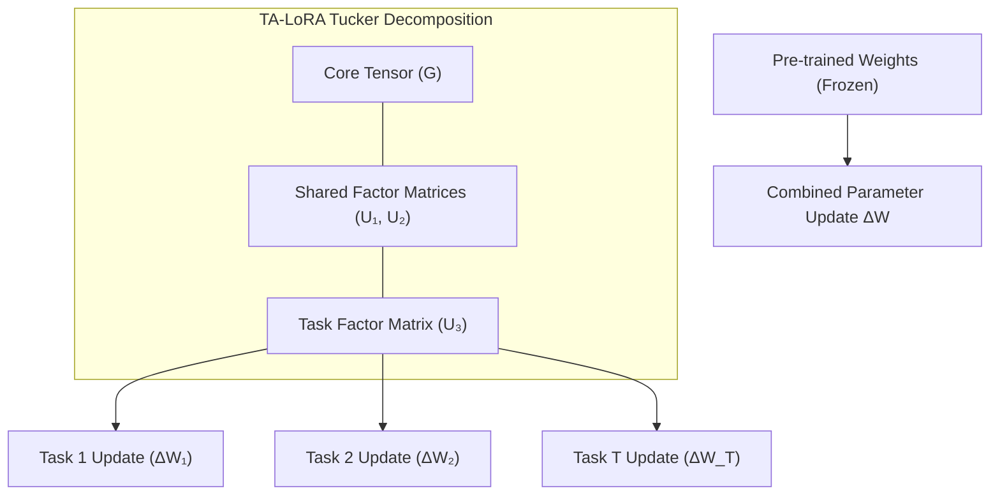
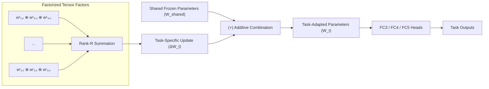
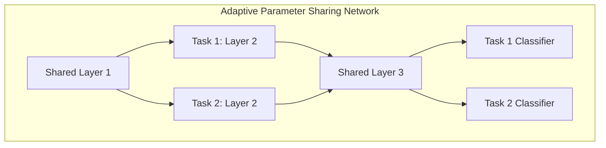

# Decomposition Architectures (2020 Onwards)

---

## Slide 1: Tucker Tensor-Based Parameter Decomposition (TA-LoRA)

**Reference:** Wang et al., *"Task-Aware Low-Rank Adaptation of Segment Anything Model"* (2024)

### Slide Content

#### Main Idea
* **Parameter-efficient MTL** using **Tucker tensor decomposition**.
* Jointly captures **shared** and **task-specific** parameter information.

#### Formulation
$$\Delta \mathcal{W} = \mathcal{G} 	imes_1 U_1 	imes_2 U_2 	imes_3 U_3$$

$$\Delta \mathcal{W} = [\Delta W_1, \Delta W_2, \dots, \Delta W_T]$$

* $\mathcal{G}$: Core tensor
* $U_1, U_2$: Shared factor matrices
* $U_3$: Task factor matrix

#### Architecture
* Applied to a **frozen pre-trained SAM encoder**.
* Stacks multi-task parameter updates into a 3D tensor.
* Decomposes the tensor into compact **core** and **factor matrices**.
* Reconstructs task-specific updates for each task.

#### Adaptation to WavCSE
* Keep WavCSE unchanged up to FC2.
* Jointly decompose updates for KS, SID, and ER after FC2.
* Apply TA-LoRA Tucker decomposition to learn shared and task-specific parameter structures jointly.

---

### Slide Transcript
Next, I will explain Tucker Tensor-Based Parameter Decomposition, based on the TA-LORA approach proposed by Wang and others in 2024.

The main idea is to achieve parameter-efficient multi-task learning by using Tucker tensor decomposition to capture both shared and task-specific parameter information.

In the original architecture, the pre-trained SAM encoder is frozen, and parameter updates from multiple tasks are stacked into a three-dimensional tensor. This tensor is then decomposed into a small core tensor, shared factor matrices, and a task factor matrix. These components are used to reconstruct the required task-specific parameter updates. To adapt this approach to WavCSE, we keep the existing architecture unchanged up to FC2.

After FC2, the parameter updates for keyword spotting, speaker identification, and emotion recognition are jointly decomposed using this Tucker-based approach. This enables efficient parameter sharing while still allowing each task to learn its own specialized parameter updates.

---

## Slide 2: Factorized Tensor Networks for MTL (FTN)

**Reference:** *"Factorized Tensor Networks for Multi-Task and Multi-Domain Learning"* (NeurIPS 2023)

### Slide Content

#### Main Idea
* Decomposes parameters into **shared** and **task-specific** components.
* Uses **low-rank tensor factorization** for parameter-efficient task adaptation.

#### Formulation
$$W_t = W_{	ext{shared}} + \Delta W_t$$

$$\Delta W_t = \sum_{r=1}^{R} w_{1,t}^r \otimes w_{2,t}^r \otimes w_{3,t}^r$$

* $W_{	ext{shared}}$: Shared frozen parameters
* $\Delta W_t$: Task-specific low-rank update
* $R$: Rank controlling task adaptation capacity

#### Architecture
* Keeps the pre-trained shared backbone frozen.
* Adds a small task-specific parameter update $\Delta W_t$ for each task.
* Represents $\Delta W_t$ using compact low-rank tensor factors.

#### Adaptation to WavCSE
* Keep WavCSE unchanged up to FC2.
* Use shared downstream base parameters after FC2.
* Add separate low-rank tensor updates for KS, SID, and ER.

---

### Slide Transcript
Next, I will explain Factorized Tensor Networks, or FTN, a parameter decomposition approach for multi-task learning.

The main idea is to separate the model parameters into shared and task-specific components, while representing the task-specific components using compact low-rank tensor factors.

In this architecture, the pre-trained shared backbone remains frozen. For each task, a small task-specific update, delta W, is added to the shared parameters. Instead of learning this update as a full parameter tensor, FTN factorizes it into smaller low-rank components, significantly reducing the number of trainable parameters.

To adapt FTN to WavCSE, we keep the existing WavCSE architecture unchanged up to FC2. After FC2, we use shared downstream base parameters and introduce separate low-rank tensor updates for keyword spotting, speaker identification, and emotion recognition. This allows efficient parameter sharing while providing task-specific specialization for each task.

---

## Slide 3: Adaptive Shared-Task-Specific Parameter Decomposition (TAPS)

**Reference:** Wallingford et al., *"Task Adaptive Parameter Sharing for Multi-Task Learning"* (CVPR 2022)

### Slide Content

#### Main Idea
* Structures parameters into **shared base weights** and **task-specific perturbations**.
* Learns which layers should be shared or task-specific for each task.

#### Formulation
$$w_i = ar{w}_i + I_	au(s_i) \delta w_i$$

* $ar{w}_i$: Shared base parameters
* $\delta w_i$: Task-specific update perturbation
* $I_	au(s_i)$: Selection gate (determines activation)

#### Architecture
* Uses shared base parameters $ar{w}_i$.
* A learned task-specific gate determines whether to activate $\delta w_i$.
* **Sparsity** encourages maximum parameter sharing across tasks.

#### Adaptation to WavCSE
* Keep WavCSE unchanged up to FC2.
* Apply TAPS to downstream parameters for KS, SID & ER.
* Learn which downstream parameters remain **shared** and which need **task-specific adaptation**.

---

### Slide Transcript
Next, I will explain TAPS, or Task Adaptive Parameter Sharing, proposed in 2022. The main idea is to structure model parameters into shared base weights and task-specific perturbations.

Instead of using completely separate parameters for every task, TAPS learns which layers can remain shared and which need task-specific adaptation. As shown in the formulation, each task starts with the shared parameters, and a learned selection gate determines whether a task-specific update should be activated.

Sparsity encourages the model to share as many parameters as possible. To adapt this to WavCSE, we keep the architecture unchanged up to FC2 and apply TAPS to the downstream models for 3 tasks.

This allows each task to selectively specialize while maintaining efficient parameter sharing across related tasks.
