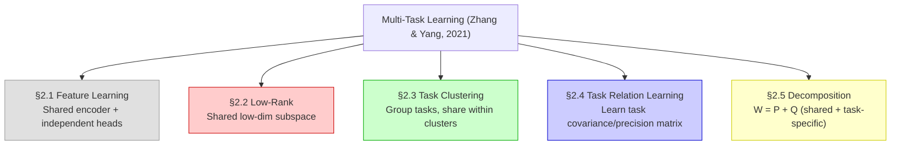
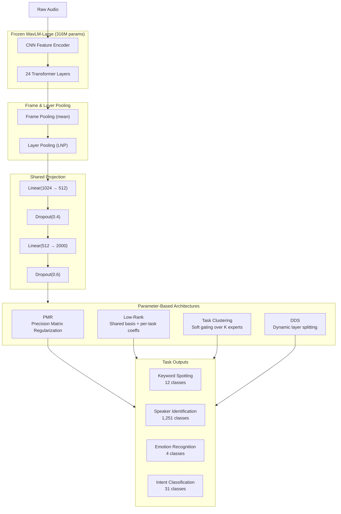
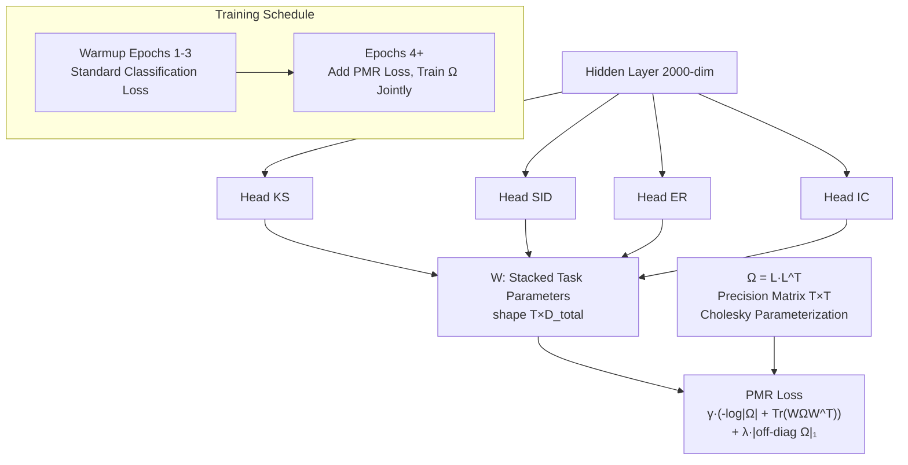
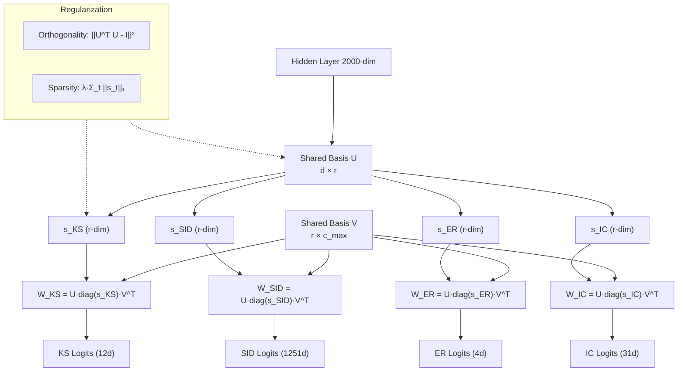
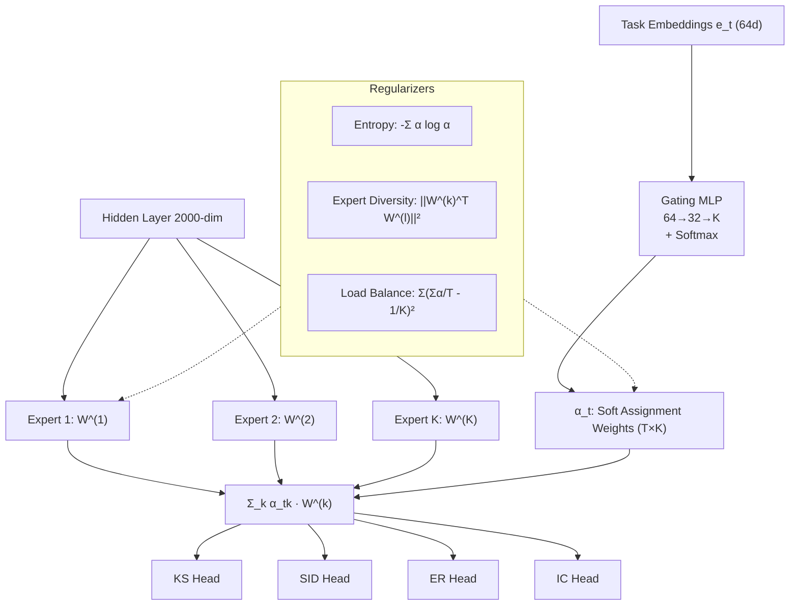
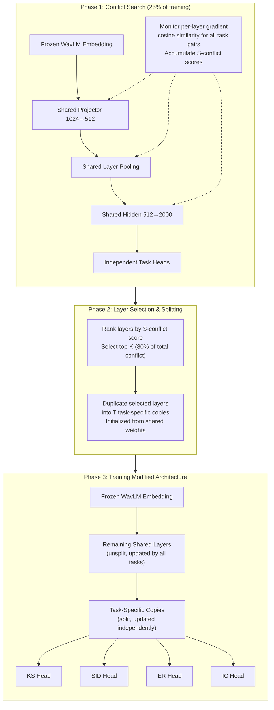
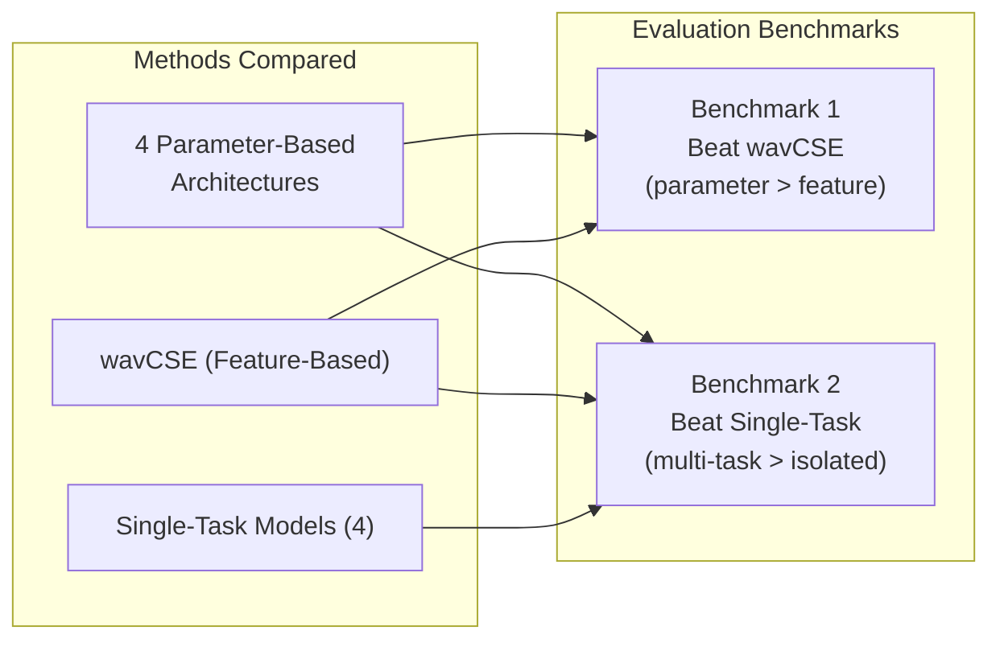

# Analyzing the Impact of Multi-task Learning Strategies on Speech Task Performance

**Research Proposal — Final Year Project**

**Supervisor:** Dr. Uthayasanker Thayasivam
**Co-supervisor:** Braveenan Sritharan
**Department of Computer Science and Engineering, University of Moratuwa**

**Team:** Kevin Sanjula, Chehan, Induwara, Pathumi

**Target Venue:** ACL 2027

---

## Abstract

Multi-task learning (MTL) enables models to jointly learn multiple related tasks by sharing information across them, often leading to improved generalization and data efficiency. While MTL has been extensively studied in computer vision and natural language processing, speech processing remains conspicuously underexplored: a systematic survey of 24 speech MTL models from 2017–2025 reveals that no model combines all four major speech task types—content, speaker, emotion, and intent—within a single unified framework, and no parameter-based MTL architecture has been developed for speech. The state-of-the-art wavCSE model (Sritharan & Thayasivam, IJCNLP 2025) employs feature-based MTL with a frozen WavLM-Large backbone and independent task heads, achieving strong performance on three speech tasks. However, its feature-based paradigm imposes fundamental limitations: tasks interact only indirectly through a shared hidden representation, there is no mechanism for explicit task relationship modeling, and equal-weight loss averaging cannot address the extreme dataset imbalance between tasks such as speaker identification (1,251 classes, ~138,000 samples) and emotion recognition (4 classes, ~4,500 samples).

This research addresses these limitations by developing the first parameter-based multi-task learning architectures for speech processing. We adapt four parameter-sharing strategies from the Zhang and Yang (2021) taxonomy—Precision Matrix Regularization (Task Relation Learning), Low-Rank Parameter Subspaces, Task Clustering via Soft Assignment, and Decomposition-Based Dynamic Splitting—to operate on the wavCSE backbone. Each architecture explores a distinct mechanism for explicit task relationship modeling: a learned task precision matrix that encodes conditional independence, a shared low-rank basis with per-task coefficient vectors, a gating network that produces soft cluster assignments over expert classifiers, and gradient-conflict-driven dynamic layer splitting that creates task-specific copies at high-conflict layers. A modular experimental framework, built on wavCSE's downstream pipeline, will enable systematic comparison across architectures, gradient-based optimization strategies (PCGrad, CAGrad, Nash-MTL, FairGrad), and task combinations. The architectures will be evaluated against two benchmarks: the feature-based wavCSE model, to quantify the benefit of explicit parameter-based task relationship modeling, and single-task models, to verify that multi-task training outperforms isolated learning. Through interpretable visualizations of task affinity matrices, precision matrices, layer-wise conflict heatmaps, and sparse structure matrices, this work will provide the first systematic characterization of speech task relationships, actionable design guidelines for practitioners, and a publicly available Python library for reproducible MTL research in speech. The findings are targeted for publication at ACL 2027.

**Keywords:** multi-task learning, speech processing, parameter-based MTL, task imbalance, task relationship learning, precision matrix, low-rank decomposition, task clustering, gradient conflict

---

## 1. Introduction

Multi-task learning (MTL) is a machine learning paradigm in which a single model is trained to solve multiple related tasks simultaneously, leveraging shared information across tasks to improve generalization performance. Rather than learning each task in isolation, MTL exploits the inductive bias that tasks draw upon shared underlying representations, enabling the model to develop richer features from the combined supervisory signal. As Zhang and Yang (2021) formalize in their comprehensive survey, the central design questions in MTL revolve around three axes: *what* to share across tasks, *how* to structure the sharing mechanism, and *when* sharing is beneficial versus harmful. The first question concerns which layers or parameters of a neural network should be shared between tasks. The second addresses the architectural mechanism for sharing, ranging from hard parameter sharing (identical layers) to soft constraints (regularization penalties) to learned task relationships. The third, and perhaps most subtle, involves determining under what conditions multi-task training outperforms single-task training, considering factors such as task similarity, dataset sizes, and gradient conflicts. Each of these design choices carries significant consequences for model performance, and their optimal configuration remains an active area of research.

Within the landscape of MTL architectures, a fundamental distinction exists between **feature-based** and **parameter-based** approaches. Feature-based MTL, the more widely adopted variant, learns a shared encoder that produces a unified representation, followed by independent task-specific heads that operate on this shared feature space. The interaction between tasks in this paradigm is indirect: tasks influence one another only through the gradient signals that update the shared encoder parameters, meaning that task relationships are implicitly encoded in the learned representation rather than explicitly modeled. This approach, exemplified by the shared-bottom architecture and its many variants, is conceptually simple and computationally efficient, but it makes strong assumptions about the suitability of a single representation for all tasks. Parameter-based MTL, by contrast, introduces structured parameter sharing mechanisms that explicitly model relationships between tasks. These methods include learning a task covariance or precision matrix that encodes pairwise conditional independence relationships between tasks (Zhang & Yeung, 2010), clustering tasks into groups that share specialized layers with soft assignment weights (Jacob et al., 2008; Fifty et al., 2021), decomposing task parameters into a shared low-rank basis with per-task coefficient vectors (Argyriou et al., 2007; Ando & Zhang, 2005), and dynamically splitting shared layers into task-specific copies when gradient conflicts exceed a threshold (Shi et al., 2023). The defining characteristic of parameter-based MTL is that task interactions are parameterized directly in the weight space of the network, rather than emerging indirectly through the hidden representation space.

Speech processing presents a particularly compelling testbed for MTL because speech signals inherently carry information across multiple, fundamentally distinct dimensions. When a person speaks, their utterance simultaneously conveys **what** is being said (linguistic content), **who** is speaking (speaker identity), **how** it is being said (emotional state), and **what the speaker intends** (communicative intent). These four task types draw on different layers of the speech signal yet share overlapping low-level acoustic features. Content, operationalized as keyword spotting, requires the model to recognize phonetic and lexical patterns regardless of who is speaking or their emotional state—it demands invariance to speaker and paralinguistic variation. Speaker identification requires the model to attend to vocal tract characteristics, pitch range, and speaking style that are consistent across different utterances from the same person, demanding invariance to linguistic content. Emotion recognition operates on prosodic features—pitch contours, speaking rate, voice quality—that overlay the linguistic signal and carry affective information. Intent classification sits at the semantic level, requiring the model to infer the goal behind an utterance from its content combined with contextual cues. This combination of shared low-level structure with task-specific high-level differentiation makes speech a natural candidate for MTL, where the sharing mechanism can be tuned to capture precisely this pattern of overlapping and divergent representations.

The case for multi-task learning in speech processing extends beyond architectural considerations to fundamental principles of human perception and practical engineering constraints. Humans process speech holistically: a listener does not first decode the words, then separately identify the speaker, and finally infer the emotion. Rather, all of these dimensions are perceived simultaneously through a unified auditory processing system, with different aspects of the signal being extracted in parallel across interconnected processing streams (Friederici, 2011). MTL offers a computational analog to this holistic processing by learning representations that capture multiple facets of the speech signal concurrently. Beyond this biological motivation, MTL brings several concrete benefits. First, shared acoustic representations can improve data efficiency: low-level phonetic features learned from large keyword spotting datasets can benefit emotion recognition, which typically suffers from limited labeled data (the largest emotion datasets contain on the order of 5,000–10,000 utterances, compared to over 100,000 for speaker identification). Second, the inductive bias introduced by MTL acts as a regularizer, reducing the risk of overfitting on tasks with small datasets by constraining the model to learn representations that generalize across multiple output spaces. Third, joint training can serve as a form of feature enrichment: by requiring the model to represent information relevant to multiple tasks simultaneously, each individual task benefits from features it might not have learned on its own. Fourth, from a deployment perspective, a single multi-task model replaces multiple single-task models, reducing memory footprint and inference latency—a significant advantage for speech applications on resource-constrained devices.

Despite the maturity of MTL research in other domains, speech processing remains conspicuously underexplored. In computer vision, MTL has been extensively studied through benchmarks such as NYU-v2 (Silberman et al., 2012) for dense prediction tasks, Cityscapes (Cordts et al., 2016) for autonomous driving, and the Taskonomy dataset (Zamir et al., 2018) for studying task transfer and relationships. These benchmarks have enabled systematic comparison of dozens of MTL architectures, weighting strategies, and optimization methods. Similarly, in natural language processing, multi-task benchmarks such as GLUE (Wang et al., 2018) and SuperGLUE (Wang et al., 2019) have driven progress by providing standardized evaluation protocols across diverse linguistic tasks. Yet no equivalent benchmark or systematic study exists for MTL in speech. The closest approximation is the SUPERB benchmark (Yang et al., 2021), which evaluates self-supervised speech representations across a suite of downstream tasks, and the wavCSE model (Sritharan & Thayasivam, 2025), which introduces feature-based MTL for three speech tasks. Critically, both SUPERB and wavCSE follow the feature-based paradigm exclusively: they freeze a pre-trained speech backbone, extract a fixed-size embedding, and train independent linear classifiers on top. As we demonstrate in Section 4.1 through a comprehensive survey of 24 speech MTL models from 2017–2025, no existing model combines all four speech task types within a single MTL framework, and no parameter-based MTL architecture has ever been developed for speech processing.

This proposal outlines a systematic investigation of parameter-based multi-task learning strategies for speech processing. We aim to develop four parameter-based MTL architectures—each from a distinct branch of the Zhang and Yang (2021) taxonomy—adapted for speech tasks. A modular experimental framework will be built on the wavCSE downstream pipeline, enabling controlled experiments across architectures, weighting strategies, and task combinations. The proposed architectures will be evaluated against two baselines: the feature-based wavCSE model, to quantify the benefit of explicit parameter-based task relationship modeling, and single-task models trained independently, to verify that multi-task training improves upon isolated learning. Through this investigation, we seek to provide the first systematic comparison of MTL strategies for speech, interpretable insights into speech task relationships, and actionable design guidelines for practitioners building multi-task speech systems.

---

## 2. Problem Statement

The central problem motivating this research is the absence of parameter-based multi-task learning architectures for speech processing, and in particular the absence of any model that jointly learns across all four major speech task types—content, speaker, emotion, and intent—using structured parameter sharing. Current speech MTL models, including the state-of-the-art wavCSE (Sritharan & Thayasivam, 2025), are confined to the feature-based paradigm: a frozen self-supervised speech backbone extracts generic features, a shared projection layer maps these into a unified embedding space, and lightweight task-specific classifiers operate on this shared representation independently. While wavCSE achieves strong performance on three speech tasks (98.81% on keyword spotting, 97.59% on speaker identification, and 79.39% on emotion recognition), its architecture imposes fundamental constraints:

**No explicit task relationship modeling.** Tasks interact only indirectly through the shared hidden representation. There is no mechanism to determine which tasks benefit from sharing and which experience negative transfer. The model cannot learn, for example, that keyword spotting and intent classification share phonetic feature requirements and should exchange more information, while speaker identification and emotion recognition may compete for voice-quality features and should be partially isolated. In computer vision, parameter-based methods such as task covariance learning (Zhang & Yeung, 2010), cross-stitch networks (Misra et al., 2016), and task affinity grouping (Fifty et al., 2021) explicitly model which parameters should be shared and to what degree. No equivalent exists for speech.

**No model combines all four speech task types.** WavCSE addresses three tasks (keyword spotting, speaker identification, and emotion recognition). As our systematic survey in Section 4.1 demonstrates, across 24 speech MTL models from 2017–2025, no model jointly learns content, speaker, emotion, and intent tasks together. The most comprehensive models cover at most three tasks on the linguistic-paralinguistic spectrum. Each additional task type introduces new dimensions of task interaction—positive transfer from shared acoustic features, negative transfer from conflicting representational demands, and gradient interference during joint optimization—that remain entirely uncharacterized for speech.

**Extreme task imbalance is unaddressed.** Speech datasets exhibit severe imbalance: speaker identification on VoxCeleb1 involves 1,251 classes across approximately 138,000 utterances, while emotion recognition on IEMOCAP involves 4 classes across approximately 4,500 utterances. This represents a difference of two orders of magnitude in both class count and sample count. Equal-weight loss averaging, as used in wavCSE, allows the large task to dominate gradients to the detriment of smaller tasks. The pooled accuracy criterion for checkpoint selection inevitably favors the larger task, potentially at the expense of smaller tasks with different evaluation sensitivity. While gradient-based optimization methods (PCGrad, CAGrad, Nash-MTL, FairGrad) have been developed to address task imbalance in computer vision, their effectiveness under the extreme imbalance conditions characteristic of speech remains entirely unexamined.

**No systematic comparison of MTL strategies exists for speech.** The computer vision community has established standardized benchmarks and comprehensive comparisons across MTL architectures, loss-weighting strategies, and optimization methods through frameworks such as LibMTL (Lin & Zhang, 2023). The speech community lacks any equivalent. Without such comparison, practitioners have no empirical basis for selecting an MTL strategy for speech applications—whether to use feature-based or parameter-based sharing, which parameter-sharing mechanism is most effective, and whether gradient surgery methods justify their computational overhead.

**No task affinity analysis exists for speech.** In computer vision, task affinity matrices (Fifty et al., 2021) and task taxonomy analyses (Zamir et al., 2018) reveal which tasks benefit from joint training and why. These analyses show, for example, that low-level visual tasks (depth estimation, surface normal prediction) form a natural cluster with high mutual affinity, while higher-level tasks (semantic segmentation, object detection) cluster separately. No equivalent analysis exists for speech. We do not know whether keyword spotting and emotion recognition—which share sensitivity to temporal prosodic patterns—exhibit higher mutual affinity than speaker identification and emotion recognition—which share sensitivity to vocal tract characteristics. We do not know at which layers parameter sharing is most beneficial for speech tasks. And we do not have precision matrices or dependency graphs showing the conditional independence structure of speech tasks—information that could directly inform the design of more efficient and accurate shared architectures.

Adapting parameter-based MTL methods from computer vision to speech processing presents several non-trivial challenges. First, speech models typically rely on large frozen self-supervised backbones (such as WavLM with 316 million parameters) that are computationally expensive to fine-tune. Parameter-based methods developed for computer vision often assume that the full backbone is trainable and that task-specific modifications can be applied at any layer. Adapting these methods to speech requires designing parameter sharing mechanisms that operate on the downstream projection and classification layers—typically 1D temporal representations at the output of transformer layers—rather than on the convolutional filter banks that dominate vision architectures. Second, speech representations are inherently temporal: a typical utterance is a sequence of frame-level features spanning hundreds or thousands of timesteps, and pooling this temporal information into a fixed-size utterance-level embedding is itself a design decision that interacts with MTL architecture choices. Different tasks may benefit from different pooling strategies—emotion recognition may be sensitive to fine-grained temporal dynamics, while speaker identification may benefit from global statistics over the full utterance—yet in standard feature-based MTL all tasks are forced to use the same pooling operation. Third, the scale of task imbalance in speech processing is extreme, with dataset sizes and class counts varying by orders of magnitude across tasks, creating severe gradient dominance issues where the large task overwhelms smaller tasks during optimization.

Formally, this research addresses the following interconnected gaps: (i) there are few MTL models in speech processing, and none that use parameter-based architectures; (ii) no model combines all four speech task types (content, speaker, emotion, intent) within a single framework; (iii) no systematic comparison of MTL strategies has been conducted for the speech domain; and (iv) the task affinity structure of speech tasks—which tasks help or hinder each other, at which layers, and under what conditions—remains entirely uncharacterized. We address these gaps by adapting four parameter-based MTL strategies from the Zhang and Yang (2021) taxonomy, developing a modular experimental framework, and conducting the first systematic evaluation of parameter-based MTL for speech tasks.

---

## 3. Research Objectives

1. **To design and implement** four parameter-based multi-task learning architectures adapted for speech processing, each exploring a distinct parameter-sharing strategy from the Zhang and Yang (2021) taxonomy: Precision Matrix Regularization (Task Relation Learning, §2.4), Low-Rank Parameter Subspaces (§2.2), Task Clustering via Soft Assignment (§2.3), and Decomposition-Based Dynamic Splitting (§2.5). All architectures operate on the frozen WavLM-Large backbone and the wavCSE downstream pipeline, ensuring that architectural comparisons isolate the effect of the parameter-sharing mechanism.

2. **To develop** a modular and extensible Python framework for systematic comparison of MTL architectures, built on the wavCSE downstream pipeline. The framework will provide a unified interface for swapping architectures, weighting strategies, and task combinations, with automated logging of training dynamics including gradient magnitudes, per-task loss scales, gradient conflict rates, and per-task performance metrics.

3. **To analyze** how different parameter-sharing strategies affect individual task performance across content (Keyword Spotting), speaker (Speaker Identification), emotion (Emotion Recognition), and intent (Intent Classification) tasks. This analysis will produce interpretable visualizations of task relationships—precision matrices revealing conditional independence structures, sparse structure matrices showing task groupings, layer-wise conflict heatmaps identifying where parameter sharing helps or harms specific task pairs, and task affinity matrices quantifying pairwise transfer benefits. These analyses will provide the first systematic characterization of speech task relationships in a multi-task setting.

4. **To examine** the effect of task imbalance on multi-task training dynamics and evaluate gradient-based optimization methods—including Uncertainty Weighting, PCGrad, CAGrad, Nash-MTL, and FairGrad—as strategies to mitigate performance degradation on data-poor tasks. This analysis will address the extreme imbalance conditions characteristic of speech datasets, where speaker identification and emotion recognition differ by two orders of magnitude in both class count and sample count.

5. **To benchmark** the proposed parameter-based architectures against two baselines: (i) the feature-based wavCSE model, to quantify the benefit of explicit parameter-based task relationship modeling, and (ii) single-task models trained independently, to verify that multi-task training improves upon isolated learning.

6. **To prepare** findings for publication at ACL 2027, contributing the first systematic comparison of parameter-based MTL strategies for speech processing, a publicly available Python library for reproducible MTL research in speech, and actionable design guidelines for practitioners building multi-task speech systems.

---

## 4. Literature Review

### 4.1 Multi-Task Learning in Speech Processing

The dominant paradigm for multi-task learning in speech processing has been feature-based MTL, where tasks share a frozen or jointly fine-tuned encoder while operating through independent task-specific heads. This approach has proven effective because the hierarchical nature of acoustic representations lends itself naturally to shared feature extraction: early layers capture fundamental acoustic properties such as pitch and formants, intermediate layers encode phonetic and phonological structure, and deeper layers abstract toward semantic and paralinguistic content (Baevski et al., 2020; Hsu et al., 2021; Chen et al., 2022).

The most comprehensive evaluation of this paradigm is the SUPERB benchmark (Yang et al., 2021), which systematically evaluates self-supervised speech representations across ten diverse downstream tasks including phoneme recognition, keyword spotting, speaker identification, emotion recognition, and intent classification. SUPERB demonstrated that a single frozen WavLM or HuBERT encoder, paired with lightweight task-specific prediction heads, can achieve competitive or state-of-the-art performance across multiple speech tasks. However, it is critical to note that SUPERB does not perform multi-task learning in the strict sense: each task is trained independently from the shared frozen encoder, meaning there is no joint optimization and no mechanism for tasks to influence each other's representations during training. SUPERB is better characterized as a shared-feature evaluation protocol rather than a true MTL architecture.

The wavCSE model (Sritharan & Thayasivam, 2025) represents the current state of the art for genuine multi-task learning in speech. WavCSE employs a two-stage pipeline: Stage 1 uses a frozen WavLM-Large encoder (316M parameters, 24 transformer layers) to extract 1024-dimensional frame-level features, which are aggregated through learnable frame pooling to produce fixed-size utterance-level embeddings. Stage 2 trains a downstream multi-task model consisting of a linear projection layer (1024→512), layer pooling (learned-norm pooling over 16 selected layers), a hidden layer (512→2000 with ReLU), and three independent linear classification heads for keyword spotting (KS, 12 classes), speaker identification (SID, 1,251 classes), and emotion recognition (ER, 4 classes). Training uses equal-weight loss averaging: L_total = (L_KS + L_SID + L_ER) / 3. Despite this simplicity, wavCSE achieved state-of-the-art results on the KS-SID-ER triplet: 98.81% on KS, 97.59% on SID, and 79.39% on ER, outperforming the WavLM single-task baseline by margins of 0.95, 2.10, and 8.77 percentage points respectively.

Despite its empirical success, wavCSE's feature-based paradigm imposes four specific limitations that motivate the present work. First, tasks interact only indirectly through the shared hidden representation—there is no mechanism for modeling which tasks reinforce or compete with each other, and no way to learn task-specific sharing patterns from data. Second, equal-weight loss averaging cannot address the extreme imbalance between a 1,251-class speaker identification task and a 4-class emotion recognition task. Third, independent prediction heads prevent cross-task statistical sharing even when tasks share underlying structure—for example, the well-established relationship between prosodic features and emotional expression. Fourth, the architecture assumes a single shared hidden representation suffices for all tasks, ignoring evidence from computer vision that different tasks benefit from different levels of feature abstraction and different degrees of parameter sharing.

#### Existing Speech MTL Models: A Systematic Classification

To establish the evidence base for the research gap, we conducted a systematic survey of multi-task learning models in speech processing from 2017 to 2025. The following table classifies 24 speech MTL models by task combination, number of tasks, MTL paradigm, and architecture type.

<!-- DIAGRAM D9: Speech MTL Landscape — comprehensive classification table -->

| Paper | Year | Tasks Combined | Task Count | MTL Paradigm | Architecture |
|-------|------|---------------|-----------|-------------|-------------|
| Tang et al. | 2017 | ASR + Speaker Recognition | 2 | Parameter (hard sharing) | Collaborative RNN with inter-task connections |
| Chen et al. (UniSpeech-SAT) | 2021 | SSL pre-training (10 SUPERB tasks evaluated independently) | 10 (pre-training) | Parameter (SSL pre-training) | HuBERT + utterance-wise contrastive + mixing |
| Hussain et al. | 2021 | KWS + Speaker Verification | 2 | Feature-based (frozen) | wav2vec 2.0 shared backbone + task heads |
| Yang et al. (SUPERB) | 2021 | PR, KS, QbE, SID, ASV, SD, IC, SF, ER (10 tasks) | 10* | Feature-based (frozen) | Frozen SSL + task-specific heads (*not joint training) |
| Siohan | 2022 | Audio-Visual ASR + Active Speaker Detection | 2 | Parameter (hard sharing) | Single audio-visual model + multi-task loss |
| Zheng et al. | 2022 | VAD + Speaker Classification + ASR | 3 | Parameter (hard sharing) | Shared Wav2Vec 2.0 + layer-specific task assignment |
| Lin et al. | 2022 | Speech Separation + ASR | 2 | Parameter (joint training) | Dual-path Conformer separator + joint CTC/attention |
| Liu & Zhang (ASP-MTL) | 2023 | SER + Noise Recognition; SER + Gender Recognition | 2 | Parameter (shared-private) | Adversarial shared-private LSTM + orthogonal constraints |
| Ghosh et al. (MMER) | 2023 | SER + ASR (auxiliary) + Contrastive | 2 | Parameter (joint training) | wav2vec 2.0 + RoBERTa + cross-modal attention |
| Wu et al. | 2023 | VAD + Speaker ID + ASR + Emotion | 4 | Parameter (hard sharing) | Shared WavLM encoder + 4 downstream heads |
| Zhang & Liu (SU-MTFI) | 2023 | Speaker Recognition (multiple x-vector tasks) | 2 | Parameter (shared-private) | Shared unit + attention-based statistical pooling |
| Arora et al. (UniverSLU) | 2024 | ASR + IC + ER + NER + SCR + SF (12 tasks, 17 datasets) | 12 | Parameter (instruction-tuned) | Whisper fine-tuned with NL instructions |
| Suresh et al. | 2024 | ASR + Phoneme Rec + IC + Slot Filling + SER | 5 | Parameter (adapter-based) | Adapter-based fine-tuning of encoder-decoder SSL |
| Das et al. (SpeechVerse) | 2024 | ASR + IC + SF + ER + ST (11 tasks) | 11 | Feature-based (frozen + LoRA) | Frozen WavLM + Flan-T5-XL with LoRA |
| Phukan et al. (TANGO) | 2024 | Speaker Rec + SER + Gender Rec + Age Est | 4 | Parameter (multi-view fusion) | Multi-view fusion of WavLM, Wav2vec2, Whisper |
| Futami et al. | 2024 | ASR + IC + ER (extended to 7 tasks) | 7 | Parameter (pruned subnetworks) | UniverSLU + multi-task pruning (lottery ticket) |
| Si et al. (HarmoniFuse) | 2025 | ASR + SER | 2 | Parameter (gated/prompt-adaptive) | Gated WavLM + prompt-adaptive dynamic fusion |
| Zgorzynski et al. | 2025 | Emotion + Arousal/Valence/Dominance | 2 | Parameter (multi-encoder) | Whisper + WavLM + RoBERTa fusion |
| HCLD (ICASSP 2025) | 2025 | SER + Speaker Verification | 2 | Parameter (contrastive) | Hybrid contrastive decoupling loss |
| Jin et al. (S-MoE) | 2025 | ASR + Speech Translation | 2 | Parameter (MoE) | Supervised MoE with guiding token routing |
| Ren et al. | 2025 | Emotion Recognition + Intent Recognition | 2 | Parameter (joint training) | End-to-end acoustic + linguistic + semi-supervised |
| **Sritharan & Thayasivam (wavCSE)** | **2025** | **KS + SID + ER** | **3** | **Feature-based (frozen)** | **Frozen WavLM + recursive layer selection + task heads** |
| Chen et al. (MTLSER) | 2025 | SER + ASR + Speaker ID | 3 | Feature-based (frozen) | Frozen wav2vec 2.0 + task-specific heads |
| He et al. (M4SER) | 2025 | SER + ASR Error Detection + ASR Error Correction | 3 | Feature-based (frozen) | HuBERT + BERT + adversarial + contrastive |

**Key findings from the survey.** Of the 24 models surveyed: (i) zero models combine all four target task types (content, speaker, emotion, intent); (ii) zero models employ parameter-based MTL architectures drawn from the Zhang and Yang (2021) taxonomy—every model relies on either a frozen feature-based backbone with independent heads or hard parameter sharing with no explicit task relationship modeling; (iii) the maximum task coverage on the linguistic-paralinguistic-intent spectrum is three tasks (wavCSE: KS + SID + ER; MTLSER: ASR + SID + ER); (iv) 18 of 24 models focus on emotion recognition as the primary task with auxiliary support; (v) no model includes both speaker identification and intent classification simultaneously. These findings conclusively establish the research gap: there exist no parameter-based MTL architectures for speech, and no existing model jointly learns all four task types within a structured parameter-sharing framework.

### 4.2 Parameter-Based MTL: A Taxonomy

Zhang and Yang (2021), in their comprehensive survey published in IEEE Transactions on Knowledge and Data Engineering, organize multi-task learning into five fundamental categories based on *how* tasks share information. This taxonomy provides a principled framework for understanding the design space of MTL architectures and for identifying which approaches are most promising for adaptation to the speech domain.

<!-- DIAGRAM D1: MTL Taxonomy (Zhang & Yang 2021) — 5 branches with color coding -->


The Feature Learning category (§2.1), encompassing both simple shared-bottom architectures and more sophisticated shared-private and mixture-of-experts designs, is the most extensively implemented. LibMTL (Lin & Zhang, 2023), a unified PyTorch benchmark published in the Journal of Machine Learning Research, provides implementations of eight feature-based architectures (HPS, Cross-Stitch, MMoE, CGC, PLE, MTAN, DSelect-k, LTB) and twenty-four loss-weighting strategies (EW, UW, GradNorm, MGDA, PCGrad, CAGrad, Nash-MTL, FairGrad, RLW, and others).

Critically, LibMTL does not implement methods from the remaining four categories. These four categories—Low-Rank, Task Clustering, Task Relation Learning, and Decomposition—represent the frontier of parameter-based MTL, where tasks interact not merely through a shared feature space but through structured parameter couplings, learned task affinity graphs, clustered parameter sharing patterns, and decomposed weight matrices. Each category addresses a different aspect of the fundamental MTL challenge: how to determine which parameters should be shared across which tasks, and how to optimize the resulting architecture. The following subsections review each branch in detail, establishing the theoretical foundation for the four architectures developed in this work.

### 4.3 Task Relation Learning

Task Relation Learning (TRL) represents the most principled approach to modeling inter-task dependencies in multi-task learning. Rather than assuming a fixed sharing structure or learning one implicitly through optimization, TRL methods explicitly parameterize and learn the relationships between tasks, typically through a task covariance matrix Ω or precision matrix Ω⁻¹ that captures pairwise task affinities. This approach offers both practical benefits—improved generalization through appropriate information sharing—and analytical value, as the learned relationship matrix provides interpretable insight into which tasks benefit from joint modeling.

**Theoretical formulation.** The core formulation assumes task parameters follow a matrix-normal prior: W ~ MN(0, I, Ω), where W is the matrix of all task parameters (stacked per-task weight vectors) and Ω is the T×T task covariance matrix. The training objective includes a regularization term: λ · tr(W · Ω⁻¹ · W^T). This term penalizes task parameters that deviate from the covariance structure encoded in Ω. When Ω_ij is large (tasks i and j are positively related), the penalty pushes w_i and w_j to be similar. When Ω_ij is small or negative, the penalty allows or encourages divergence. The precision matrix Ω⁻¹ has a direct probabilistic interpretation: a zero in position (i,j) means tasks i and j are conditionally independent given all other tasks—they have no direct relationship beyond what is mediated through other tasks.

**Historical development.** Bonilla et al. (2007, NIPS) introduced Multi-task Gaussian Processes (MTGP), which learns a task covariance matrix from data using Gaussian Process regression—the first method to treat task relationships as learnable parameters rather than pre-specified constants. Zhang and Yeung (2010, UAI) proposed the convex MTRL formulation, which learns the precision matrix Ω⁻¹ through convex optimization, providing theoretical guarantees on convergence and recovery of the true task structure. The journal version (Zhang & Yeung, 2014, ACM TKDD) extended this with rigorous generalization bounds. Zhang and Schneider (2010, NIPS) introduced a sparse matrix-normal penalty that simultaneously learns task relationships and performs feature selection through a joint L1 penalty on the precision matrix. Lee et al. (2016, ICML) introduced asymmetric task relationships, recognizing that knowledge transfer between tasks may be directional—a high-resource task may benefit a low-resource task more than the reverse. Long et al. (2017, NIPS) developed Multilinear Relationship Networks, extending TRL to deep neural networks by learning a multilinear relationship tensor across multiple layers. Gonçalves et al. (2016, JMLR) proposed Multi-task Sparse Structure Learning (MSSL) with Gaussian copula models, which jointly learns a sparse precision matrix capturing conditional independence among tasks while modeling arbitrary marginal distributions through copula transformations—a formulation directly motivating the PMR architecture in this work.

**Modern context.** Among post-2020 work, Kanakis et al. (2020, ECCV) proposed reparameterizing classifier heads with a learned task correlation matrix—the closest modern equivalent to the classical TRL formulation—though it uses reparameterization rather than a Bayesian regularizer and was developed for incremental learning rather than joint multi-task training. The three parameter-coupling architectures currently implemented in the wavCSE improvements framework (GBC, TSM, PMR) each explore different TRL-derived mechanisms, with PMR being the most directly grounded in the MSSL probabilistic framework.

**Relevance to speech.** Task relation learning offers compelling advantages for speech MTL. The learned precision matrix provides an interpretable dependency graph among content, speaker, emotion, and intent tasks, answering fundamental questions about which speech tasks benefit each other. The parameter-level interaction mechanism operates at a different level from wavCSE's feature-level sharing, potentially capturing cross-task dependencies that feature sharing alone cannot model. The sparsity-inducing regularization on off-diagonal entries of the precision matrix naturally isolates unrelated tasks, directly addressing the negative transfer risk that is a central concern in speech MTL.

### 4.4 Task Clustering

Task clustering methods partition tasks into groups and share parameters only within each group, addressing a fundamental tension in multi-task learning: training too many unrelated tasks together degrades performance through negative transfer, but training each task independently forfeits the statistical benefits of sharing. Unlike the continuous parameter sharing of Task Relation Learning, clustering makes a discrete structural assumption—tasks form natural groups, and sharing should be strongest within each group.

**Foundational convex formulations.** Jacob, Bach, and Vert (2008, NIPS) proposed the first convex formulation of clustered MTL, where a pairwise penalty encourages task parameters within a cluster to be close while allowing large differences across clusters. This formulation jointly learns cluster assignments and shared parameters but requires the number of clusters to be specified. Passos et al. (2012, ICML) introduced flexible modeling of latent task structures using Dirichlet Process mixtures, allowing the number of clusters to be discovered nonparametrically from data. Kumar and Daume (2012, ICML) developed the GO-MTL framework, where each task parameter vector is modeled as a sparse linear combination of k latent task bases: W = L · S, where L contains k latent bases and S is a sparse coefficient matrix whose sparsity pattern encodes task grouping. Tasks that share nonzero coefficients in the same rows of S are effectively in the same cluster. Zhou and Zhao (2016, IEEE TPAMI) proposed learning representative tasks—selecting a small set of exemplar tasks that best characterize each cluster—for robustness to outlier tasks. Yao et al. (2019, KDD) proposed Robust Clustered MTL (RCMTL), which jointly clusters tasks and identifies outlier tasks using a capped-Lp penalty. Zhang et al. (2022, STCMTL) introduced semisoft task clustering with mixed membership, allowing each task to be a linear combination of pure tasks from different clusters, bridging hard clustering and overlapping-group models.

**Modern gradient-based approaches.** The advent of deep multi-task networks shifted the clustering paradigm from parameter-space regularization to gradient-based affinity measurement. Standley et al. (2020, ICML) established the empirical foundation by exhaustively evaluating all pairwise task combinations across 20 visual tasks, demonstrating that careful task grouping consistently outperforms both full sharing and independent training. Fifty et al. (2021, NeurIPS) introduced Task Affinity Groupings (TAG), which dramatically improved efficiency by measuring inter-task affinity directly from a single jointly-trained model—taking a gradient step on task i and evaluating the loss change for task j—achieving 32× speedup over exhaustive pairwise training. Li et al. (2024, KDD) proposed Grad-TAG, which further reduces computational cost through a first-order Taylor expansion that linearizes joint training dynamics and eliminates per-pair gradient evaluations, achieving a 48× FLOP reduction compared to TAG while maintaining comparable clustering quality. Recent work includes differentiable task grouping via learned binary masks (DMTG, ICML 2024), group-theoretic alignment for task grouping (GO4Align, NeurIPS 2024), and network-based clustering via gating mechanisms (NCMTL, Mu et al., 2025).

**Relevance to speech.** Speech tasks exhibit well-understood affinities based on the acoustic features they depend on. Content tasks (keyword spotting) rely primarily on phonetic information encoded in short-time spectral features. Speaker identification depends on voice-print characteristics largely orthogonal to phonetic content. Emotion recognition draws on prosodic features—pitch contour, speaking rate, energy—distinct from both phonetic and voice-print features. Intent classification bridges acoustic dimensions with lexical content. This structure suggests a data-driven clustering regime where Grad-TAG's efficiency makes it feasible to systematically evaluate grouping hypotheses without the computational cost of exhaustive pairwise training.

### 4.5 Low-Rank Approach

The Low-Rank approach to MTL is based on the observation that the weight matrix across related tasks has approximately low rank: variations in task parameters are concentrated along a small number of shared directions, meaning the effective degrees of freedom in a multi-task model are typically much smaller than the number of parameters would suggest.

**Foundational work.** Argyriou et al. (2007, 2008) pioneered this approach by formulating MTL as learning a shared low-dimensional representation. Their method minimizes the trace norm (sum of singular values) of the task parameter matrix W, which encourages the parameters to lie in a shared low-rank subspace. The trace norm is the tightest convex relaxation of the rank function, making the optimization computationally tractable while still encouraging low-rank structure. Ando and Zhang (2005) proposed Alternating Structure Optimization (ASO), which learns a shared low-dimensional predictive structure from unlabeled data and uses it to constrain task-specific models. In ASO, each task parameter vector w_i is decomposed as w_i = u_i + Θ^T v_i, where Θ is a matrix whose rows span the shared subspace and v_i are task-specific coefficients. Chen et al. (2009, 2011) introduced robust variants using a "dirty model" approach: W = P + Q where P captures shared low-rank structure and Q captures task-specific sparse deviations. Kumar and Daume (2012) extended low-rank ideas to grouped tasks, demonstrating that tasks can be organized into a tensor structure where sharing occurs along multiple modes.

**Modern PEFT era.** The rise of parameter-efficient fine-tuning has revitalized low-rank MTL. Garg et al. (2023, NeurIPS) proposed Factorized Tensor Networks, decomposing task-specific weight updates as ΔW_t = Σ_r w_{1,t}^r ⊗ w_{2,t}^r ⊗ w_{3,t}^r, a rank-R sum of Kronecker products achieving extreme parameter efficiency. Wang et al. (2024) introduced TA-LoRA, which stacks per-task low-rank updates into a 3D tensor and applies Tucker decomposition: ΔW = G ×₁ U₁ ×₂ U₂ ×₃ U₃, where G is a compact core tensor, U₁ and U₂ capture shared structure across tasks, and U₃ distinguishes individual tasks. The parameter count grows sublinearly: adding a T-th task requires only O(R · d) additional parameters rather than O(R² · d) for full-rank adaptation. Agiza et al. (2024, CVPR) proposed MTLoRA, which achieves a 3.6× parameter reduction versus independent LoRA adapters by sharing factor matrices across tasks. Liang et al. (2025) introduced ThanoRA, which uses spectral entropy to dynamically allocate rank per layer based on the information content of singular values.

**Relevance to speech.** The low-rank assumption is theoretically well-motivated for speech tasks. Speech tasks share a compact acoustic basis: the phonetic inventory of a language, the dimensions of voice quality, the prosodic parameters of pitch, energy, and rate. These shared acoustic features occupy a low-dimensional manifold relative to the full parameter space of a deep network, suggesting that the effective rank of the multi-task weight matrix should be modest relative to the number of tasks. A low-rank architecture would decompose each task's classifier into a shared basis U, V learned across all four tasks and per-task coefficient vectors s_i that control how the shared basis is linearly combined for each task. The coefficients themselves become an interpretable representation of task similarity: tasks with similar s_i vectors share more parameter structure.

### 4.6 Decomposition Approach

Decomposition methods generalize both low-rank and task-clustering approaches by modeling task parameters as the sum of structured components, each capturing a different aspect of task relatedness. The fundamental premise is that the parameter matrix W across T tasks can be expressed as a combination of simple additive components, each regularized differently to encode distinct assumptions about task relationships.

**Foundational decomposition models.** The Dirty Model (Jalali et al., 2010, NIPS) introduced the canonical W = P + Q decomposition, where P is regularized by the L1,∞ norm (promoting row-sparsity—features shared across all tasks) and Q is regularized by the element-wise L1 norm (promoting sparse task-specific deviations). This decomposition handles mixed scenarios without pre-specifying which features belong to which category. Chen, Liu and Ye (2012, ACM TKDD) extended this with incoherence conditions: P is constrained by the trace norm to capture low-dimensional shared structure, while Q is penalized with L1 for element-wise sparsity capturing task-specific idiosyncrasies. Their key theoretical contribution was characterizing when the shared and task-specific components can be recovered exactly—specifically, when the shared subspace does not align with directions of task-specific variation (the incoherence condition). Robust MTL (Chen et al., 2011, KDD) reformulated the decomposition as W = L + S, where L is low-rank (shared) and S is column-sparse (outlier tasks), isolating entire tasks that deviate from the common structure. Zhong and Kwok (2012, ICML) unified these directions with Flexible MTL: w_i = u + Θ^T v_i + b_i, simultaneously capturing a global shared component u, a low-rank component Θ^T v_i, and a sparse task-specific component b_i.

**Hierarchical and tree-structured decomposition.** Zweig and Weinshall (2013, ICML) introduced the Hierarchical Regularization Cascade, which learns a sequence of classifiers W¹, W², ..., W^H where each level applies progressively less sharing (from group-Lasso to element-wise L1) and parameters accumulate across levels. This implicit hierarchy avoids pre-specifying a task hierarchy. Han and Zhang (2015, KDD) proposed the TAsk Tree (TAT) model, which decomposes W = Σ^H_{h=1} W_h where each W_h corresponds to a level of a latent binary tree, with structural sparsity regularizers that learn layer-specific task groupings. TAT automatically discovers whether certain tasks form sub-groups distinct from others and at which level of abstraction those groups merge.

**Modern adaptive decomposition.** Wallingford et al. (2022, CVPR) proposed Task Adaptive Parameter Sharing (TAPS), which structures each layer's parameters as w_i = w̄_i + I_τ(s_i) · δw_i, where w̄_i are frozen shared weights, δw_i is a task-specific perturbation, and I_τ is an indicator function activated when a learnable score s_i exceeds threshold τ. An L1 sparsity penalty on scores encourages maximum sharing. On the Visual Decathlon benchmark, TAPS achieved second-best performance while using approximately half the parameters of the leading method. TAPS revealed interpretable sharing patterns: on ResNet, it predominantly adapted final layers while keeping early layers shared; on Vision Transformers, it adapted attention layers throughout while freezing MLP layers.

**Gradient-based dynamic splitting.** A parallel line of work uses gradient conflict signals to determine decomposition structure dynamically during training. Recon (Shi et al., 2023, ICLR) introduced the first principled framework: during a search phase (first 25% of training), per-layer gradient conflicts are monitored. For each layer k, the S-conflict score counts how many task pairs have gradient cosine similarity below a threshold S. Layers with the highest conflict scores are duplicated into T task-specific copies, initialized from the shared weights. Full training proceeds on the modified architecture, with remaining shared layers updated by all task gradients and task-specific copies updated independently. Recon's theoretical guarantee shows that, under mild conditions on gradient norms, a single update on the modified network yields strictly lower total loss than the original shared network. Empirically, Recon reduces severe gradient conflicts by 67–80% across five benchmarks while adding only 0.26–12.77% parameter overhead. CoNAL (Yue et al., 2023, AAAI) proposes a complementary approach: when gradient conflict is detected at a shared module, gradients for that module and all subsequent shared modules are zeroed out, forcing tasks to use purely task-specific modules beyond the conflict point. GradSplit (Deng et al., 2023, WACV) splits output channels of convolutional modules into per-task groups, modifying only the backward pass to filter conflicting gradients with zero additional inference parameters.

**Relevance to speech.** The decomposition approach addresses a fundamental limitation of both wavCSE and simpler sharing methods. The heterogeneity of speech tasks—from 1,251-class speaker identification to 4-class emotion recognition—suggests that no single sharing pattern is optimal. Some layers should be fully shared (early acoustic processing), some should be partially shared (mid-level feature extraction where phonetic and prosodic features diverge), and some should be task-specific (final classification layers). Recon's dynamic splitting is particularly promising for speech because it identifies sharing decisions at the granularity of individual layers using gradient conflict as the signal, avoids pre-specifying which layers should be shared, and directly eliminates gradient conflicts at the identified layers through architectural modification.

### 4.7 Gradient-Based Optimization for Task Imbalance

Task imbalance is a well-recognized challenge in MTL. When tasks differ dramatically in dataset size, number of classes, or intrinsic difficulty, equal-weight loss averaging causes larger tasks to dominate the gradient signal, degrading performance on smaller tasks. This problem is particularly acute in speech: speaker identification (1,251 classes, ~138,000 samples) and emotion recognition (4 classes, ~4,500 samples) differ by two orders of magnitude. A range of gradient-based optimization methods have been developed to address this. These methods operate at the optimizer level—they manipulate how task-specific gradients are combined—and are applicable across any MTL architecture.

**GradNorm** (Chen et al., 2018) dynamically adjusts task weights based on gradient magnitudes, pushing all tasks to train at similar rates by balancing the L2 norm of weighted gradients. **Uncertainty Weighting** (Kendall et al., 2018) learns homoscedastic uncertainty parameters that automatically calibrate per-task loss scales, naturally down-weighting higher-noise tasks—relevant because emotion recognition labels have subjective annotator agreement often below 80%. **PCGrad** (Yu et al., 2020) projects conflicting gradients onto the normal plane of the other task's gradient, removing destructive interference between tasks during optimization. When two gradients have negative cosine similarity, PCGrad removes the conflicting component from each, requiring no hyperparameters and adding minimal computational overhead. **CAGrad** (Liu et al., 2021) generalizes PCGrad through min-max optimization: it seeks an update direction within a ball around the average gradient that minimizes the maximum loss increase across all tasks, with a single hyperparameter c controlling the radius. CAGrad is provably guaranteed to converge to a Pareto stationary point. **Nash-MTL** (Navon et al., 2022) formulates gradient aggregation as a Nash bargaining game, seeking a Pareto-stationary solution across tasks. Its key property for speech MTL is scale invariance: the solution does not depend on arbitrary scaling of individual task losses, eliminating the need for careful loss weight tuning. **FairGrad** (Baek et al., 2024) enforces fairness constraints, adapting weights to reduce accuracy disparities across tasks with an α-fairness parameter controlling the degree of protection for smaller tasks. **RLW** (Lin et al., 2022) provides a simple but effective baseline by randomly sampling loss weights from a Dirichlet distribution at each step, with the empirical finding that stochasticity itself may be beneficial for avoiding poor local minima.

While these methods have been systematically evaluated on vision benchmarks (NYU-v2, Cityscapes, Taskonomy) through LibMTL, their effectiveness on speech tasks—where the imbalance is both more extreme and differently structured—remains entirely unexamined. A key contribution of this project will be the first systematic evaluation of gradient-based optimization methods under the extreme imbalance conditions characteristic of speech MTL.

### 4.8 Research Gap Summary

The literature reviewed in the preceding sections reveals a coherent set of interconnected gaps that together define the research opportunity addressed by this work:

1. **No parameter-based MTL architectures for speech.** All 24 surveyed speech MTL models use either feature-based frozen backbones or hard parameter sharing. The four parameter-based categories from Zhang and Yang (2021)—Low-Rank, Task Clustering, Task Relation Learning, and Decomposition—have been extensively developed for computer vision but never adapted for speech processing.

2. **No model combines all four speech task types.** WavCSE covers three tasks (KS, SID, ER). No prior work jointly models content, speaker, emotion, and intent tasks together. The addition of intent classification (31 classes, semantic-level task) introduces qualitatively new task interaction dynamics that remain uncharacterized.

3. **No systematic comparison of MTL strategies for speech.** Unlike computer vision (NYU-v2, Taskonomy, LibMTL) and NLP (GLUE, SuperGLUE), speech lacks any standardized MTL benchmark or systematic architecture comparison. Without such comparison, practitioners have no empirical basis for selecting an MTL strategy for speech applications.

4. **No task affinity analysis for speech.** The relationship structure between speech tasks—which tasks reinforce or compete with each other, and at which layers—remains entirely uncharacterized. Task affinity matrices, precision matrices, and gradient conflict analyses, standard tools in vision MTL research, have never been applied to speech.

5. **Task imbalance in speech MTL is unaddressed.** Gradient-based optimization methods (PCGrad, CAGrad, Nash-MTL, FairGrad) have not been benchmarked on speech tasks, despite the extreme imbalance conditions (two orders of magnitude difference in class count and sample count) that should maximize their benefit.

These gaps converge on a central research question: **Can parameter-based MTL methods, adapted from computer vision, improve multi-task speech performance over both feature-based baselines and single-task models, while providing interpretable insights into speech task relationships?**

---

## 5. Methodology

### 5.1 System Architecture Overview

All four proposed architectures share a common backbone derived from the wavCSE downstream pipeline. This ensures that architectural comparisons are not confounded by differences in the feature extractor, data pipeline, or training setup. The two-stage pipeline decouples embedding extraction from downstream multi-task training, ensuring that all architectures train on identical input representations.

**Stage 1: Embedding Extraction.** Raw audio is passed through a frozen WavLM-Large model (316M parameters, 24 transformer layers) that produces frame-level hidden representations from all 25 layer outputs (24 transformer layers plus the CNN input projection). WavLM-Large was chosen because wavCSE demonstrated superior speech representations compared to other self-supervised models: 98.81% on keyword spotting (versus 97.86% for vanilla WavLM), 97.59% on speaker identification (versus 95.49%), and 79.39% on emotion recognition (versus 70.62%). Frame-level features undergo temporal pooling (mean pooling over the time dimension) to collapse the variable-length sequence into a fixed-size vector. The extracted embeddings are saved as .pt files on disk. Upstream extraction and downstream training are completely decoupled: once embeddings are extracted, the upstream model is no longer needed during training.

**Stage 2: Downstream Multi-Task Model.** The downstream pipeline loads pre-computed .pt embeddings and passes them through a shared backbone consisting of a linear projector (1024→512), layer pooling (learned-norm pooling over 16 selected transformer layers), a hidden layer (512→2000 with ReLU activation), and per-task classification heads. The key innovation is the **swappable architecture module** that replaces the independent per-task heads of the original wavCSE with one of four parameter-based MTL mechanisms.

<!-- DIAGRAM D2: System Architecture Overview -->


The framework is built directly on wavCSE's existing downstream infrastructure. Data loading uses the `LoadEmbedding` class, which dispatches to per-dataset embedding loaders and combines them into a unified dataset with wavCSE's index pattern mechanism for handling partially labeled samples (each sample has a label vector where only the position corresponding to its task contains a real label, and all other positions are masked in loss computation). Training uses the `MultiTasksModelTrainer` with architecture-specific extensions. Evaluation uses the `MultiTasksModelEvaluator` for per-task metrics on held-out test sets.

### 5.2 Parameter-Based MTL Architectures

The four architectures are presented as a unified design space exploration, each addressing a distinct parameter-sharing paradigm from the Zhang and Yang (2021) taxonomy. All architectures modify only the task head parameters while keeping the frozen WavLM backbone, pooling, and projection layers identical—isolating the effect of the parameter-sharing strategy on task performance.

#### 5.2.1 Precision Matrix Regularization (PMR)

**Paradigm.** Task Relation Learning (§2.4). PMR learns a task precision matrix that encodes pairwise conditional independence relationships between tasks, applying structured regularization to task parameters during training without modifying the inference architecture.

**Theoretical foundation.** PMR is derived from the Multi-task Sparse Structure Learning (MSSL) framework (Gonçalves et al., 2016), which models task parameters as draws from a multivariate Gaussian with a sparse precision (inverse covariance) matrix. The precision matrix encodes conditional independence: Ω_{ij} = 0 means tasks i and j are conditionally independent given all other tasks. This is a stronger statement than correlation—it distinguishes direct task relationships from those mediated through other tasks.

**Mechanism.** Unlike architectures that modify the forward pass, PMR leaves the model architecture completely unchanged—the forward pass is identical to the original wavCSE. The modification is entirely in the training loss. PMR constructs a task parameter matrix W by flattening and concatenating the weights and biases of all task heads (shape [T, D_total], approximately 4 × 2.6 million for the four-task setup). A learnable precision matrix Ω of shape [T × T] is parameterized via its Cholesky factor L to guarantee positive semi-definiteness: Ω = L · L^T. The PMR regularization loss is:

L_pmr = γ · (-log|Ω| + Tr(W · Ω · W^T)) + λ · |off_diag(Ω)|₁

The negative log-determinant term (-log|Ω|) prevents Ω from collapsing to zero. The trace term Tr(W · Ω · W^T) = Σ_{i,j} Ω_{ij} · w_i^T · w_j is the coupling mechanism: it encourages task parameter vectors to align in directions determined by Ω. The L1 penalty on off-diagonal entries enforces sparsity, with zero entries encoding conditional independence. The full training objective is: L_total = Σ_t L_CE(t) + L_pmr.

**Training.** PMR requires a three-epoch warmup where only the standard classification loss is used and Ω is not updated, preventing Ω from fitting to randomly initialized parameters and learning spurious structure. After warmup, the PMR loss is added and Ω is trained jointly with model parameters. The precision matrix is logged every five epochs, tracking the number of non-zero off-diagonal entries. Hyperparameters γ (regularization strength, default 0.01) and λ (sparsity, default 0.001) are tuned via grid search.

<!-- DIAGRAM D3: PMR Architecture -->


**Key properties.** PMR provides a formal probabilistic interpretation of task relationships. If Ω_{ER,SID} = 0 after training, ER and SID parameters are conditionally independent given other tasks—their correlation is mediated through other tasks. If Ω_{KS,IC} is non-zero, KS and IC have a direct relationship not explained by other tasks. The learned Ω serves as an interpretable task dependency graph. During inference, Ω is not used—the forward pass is identical to the original model, with zero inference overhead.

**Expected outcomes.** PMR should recover a dependency graph where content tasks (KS, IC) have significant non-zero precision entries while speaker and emotion tasks are more conditionally independent. The warmup prevents spurious early dependencies. The primary performance benefit is controlled negative transfer: unrelated tasks receive Ω entries near zero, and the trace term does not force their parameters to align. The secondary benefit is interpretability: the learned precision matrix provides the first empirical characterization of conditional independence relationships among speech tasks.

#### 5.2.2 Low-Rank Parameter Subspace

**Paradigm.** Low-Rank Approach (§2.2). This architecture decomposes each task's classification head weights into a shared low-rank basis and per-task coefficient vectors, exploiting the observation that effective task parameter variations are concentrated along a small number of shared directions.

**Theoretical foundation.** The architecture draws on the trace norm regularization framework of Argyriou et al. (2007, 2008), ASO's decomposition w_i = u_i + Θ^T v_i (Ando & Zhang, 2005), and the modern PEFT-era methods TA-LoRA (Wang et al., 2024) and MTLoRA (Agiza et al., 2024) that apply tensor factorization to multi-task parameter updates.

**Mechanism.** Each task's classification head weight matrix W_t (shape d × c_t, where d = 2000 is the hidden dimension and c_t is the number of classes for task t) is parameterized as:

W_t = U · diag(s_t) · V^T[:, :c_t]

where U (d × r) and V (r × c_max) are shared across all tasks, and s_t (r-dimensional vector) contains per-task coefficients. The rank r controls the degree of sharing: r = 1 forces all task heads to be scalar multiples of a single shared matrix (maximum sharing), while r = max_output_dim recovers independent heads (no sharing). For typical settings with d = 2000, c_max = 1251 (SID), and r = 16, the shared components U and V contain approximately 52,000 parameters, and each task's s_t vector adds only 16 parameters—dramatically fewer than the approximately 2.6 million parameters for four independent heads.

Two regularizers control the decomposition. An orthogonality penalty on U (||U^T U - I||_F^2) prevents the basis vectors from collapsing to the same direction. An L1 sparsity penalty on s_t (λ · Σ_t ||s_t||₁) encourages each task to use only a subset of the shared basis, providing interpretable sparsity patterns: tasks that use the same basis dimensions (non-zero in the same positions of s_t) are effectively sharing those feature transformations.

<!-- DIAGRAM D4: Low-Rank Architecture -->


**Key properties.** The coefficient vectors s_t provide an interpretable representation of task similarity: tasks with similar s_t vectors (measured by cosine similarity) share more parameter structure. The rank r provides a direct dial for the capacity-sharing tradeoff. The orthogonality constraint ensures the basis directions are distinct and complementary, preventing the trivial solution where all basis vectors converge to the same direction.

**Expected outcomes.** The coefficient vectors should reveal that content tasks (KS, IC) share basis dimensions related to phonetic feature extraction, while speaker identification uses distinct dimensions related to voice-print characteristics. A grid search over r ∈ {4, 8, 16, 32} will characterize the accuracy-efficiency Pareto frontier. The architecture should be particularly parameter-efficient given the large output dimension of SID (1,251 classes)—the 16-dimensional coefficient space dramatically compresses what would otherwise be a 2.5-million-parameter independent head.

#### 5.2.3 Task Clustering via Soft Assignment

**Paradigm.** Task Clustering (§2.3). This architecture partitions tasks into K clusters using a learned gating network that produces soft assignment weights, with each cluster maintaining its own set of expert classifiers.

**Theoretical foundation.** The architecture synthesizes GO-MTL's latent basis decomposition W = L · S (Kumar & Daume, 2012), TAG's gradient-based affinity measurement (Fifty et al., 2021), and Grad-TAG's linearized affinity approximation (Li et al., 2024), combining them into a fully learnable soft clustering mechanism.

**Mechanism.** K cluster expert classifiers W^(k) (each d × c_max) are maintained alongside a gating network. Each task is represented by a learned task embedding vector e_t (dimension 64). The gating network (a two-layer MLP with ReLU, 64→32→K) takes the task embedding and produces soft cluster assignments via softmax:

α_t = softmax(MLP_gate(e_t))

Each task's effective classifier is a weighted combination of cluster experts:

W_t = Σ_k α_tk · W^(k)[:, :c_t]

Only the columns corresponding to task t's output dimension are used from each expert. The bias terms follow the same combination: b_t = Σ_k α_tk · b^(k)[:c_t].

An optional extension conditions the gating on the input: α_t(h) = softmax(MLP_gate([e_t; h])), where h is the hidden representation and [;] denotes concatenation. This enables instance-level routing where the same task can use different expert combinations for different inputs—potentially beneficial for ambiguous emotional expressions or noisy speaker samples.

Three regularizers stabilize training. An entropy regularizer H(α) = -Σ_t Σ_k α_tk · log(α_tk) encourages each task to use a concentrated set of experts rather than distributing weight uniformly. An expert diversity penalty ||W^(k)^T · W^(l)||_F^2 for k ≠ l prevents expert collapse by keeping expert weight matrices orthogonal. A load balancing penalty Σ_k (Σ_t α_tk / T - 1/K)² ensures all experts are used across the task set.

**Training.** Training proceeds in two phases. During warmup (first 5 epochs), α_t is fixed to uniform (1/K for all k), giving each task equal access to all experts while the experts develop specialized representations. After warmup, the gating network is activated and trained jointly with the experts and regularizers.

<!-- DIAGRAM D5: Task Clustering Architecture -->


**Key properties.** The soft assignment weights α_t are directly interpretable: each row shows which experts a task relies on. A block-diagonal pattern in α (after suitable permutation) reveals task groupings. The number of clusters K is a hyperparameter; K = 2 yields a binary split (e.g., content vs. paralinguistic experts), while K = 3 or more allows finer-grained specialization.

**Expected outcomes.** Speech tasks may exhibit interpretable clustering: content tasks (KS, IC) might share one expert cluster for phonetic feature extraction, while paralinguistic tasks (SID, ER) share another cluster for voice quality and prosody analysis. The gating network could learn an intermediate structure—for example, ER might partially use both content and paralinguistic experts, reflecting its dual reliance on phonetic and prosodic features. The Grad-TAG affinity analysis will independently validate the discovered clusters by comparing them against gradient-based affinity measurements.

#### 5.2.4 Decomposition-Based Dynamic Splitting (DDS)

**Paradigm.** Decomposition (§2.5). DDS treats the shared downstream network as the P component (shared parameters) and creates task-specific copies Q_i for layers where gradient conflicts exceed a threshold, operationalizing the W = P + Q decomposition through gradient-driven architectural modification.

**Theoretical foundation.** DDS draws primarily on Recon (Shi et al., 2023, ICLR), which introduced gradient-aware dynamic layer splitting, with design elements from CoNAL (Yue et al., 2023, AAAI) for conflict detection and from TAPS (Wallingford et al., 2022, CVPR) for interpretable layer selection.

**Mechanism.** DDS operates in three sequential phases:

**Phase 1: Conflict Search (first 25% of training iterations).** The model starts with the standard wavCSE downstream architecture where all tasks share all parameters except the final classification heads. For each shared layer k (projector, layer-pooling weights, and hidden layer), the per-task gradient vectors g_i^k are captured at each iteration. For each task pair (i, j), the cosine similarity cos(φ_{ij}^k) = (g_i^k · g_j^k) / (||g_i^k|| · ||g_j^k||) is computed. An S-conflict is recorded for layer k at iteration t if cos(φ_{ij}^k) < S for any task pair (i, j), where S = -0.05 is the default severity threshold (gradients with angle > 93°). The conflict score s^k is accumulated using an exponential moving average: s_ema^k = β · s_prev^k + (1 - β) · s_t^k, with β = 0.99, enabling online accumulation without storing full gradient history.

**Phase 2: Layer Selection and Splitting.** After the search phase, layers are ranked by accumulated conflict score s_ema^k. The top-K layers are selected, where K is the smallest number such that selected layers account for 80% of total conflict, capped at the total number of trainable downstream layers (3–4 for our architecture). For each selected layer, T task-specific copies are created, initialized from the original shared weights. The remaining unselected layers continue to be shared.

**Phase 3: Full Training on Modified Architecture.** Training continues from the search-phase checkpoints on the modified architecture. The forward pass for task i uses shared layers (unchanged forward computation) for unsplit layers and task-specific private copies for split layers. The gradient update at each step applies: for remaining shared parameters, θ_sh ← θ_sh - α · Σ_t w_t · g_t^fix; for each task-specific copy, θ_t^cf ← θ_t^cf - α · g_t^cf. This directly eliminates gradient conflicts at split layers: each task's copy receives gradient signal only from its own task.

After full training, a merge analysis evaluates whether task-specific copies have converged to nearly identical parameters (cosine similarity > 0.99), providing an empirical lower bound on how much splitting was actually needed.

<!-- DIAGRAM D6: DDS Architecture — Three Phases -->


**Computational considerations.** The search phase requires storing per-layer per-task gradients for conflict computation. With 4 tasks and 3–4 trainable layers, the memory overhead is approximately 50–100 MB of additional GPU memory, negligible on modern GPUs. In the worst case where all downstream layers are split, the parameter count increases from approximately 3.8 million to approximately 15.2 million—still far smaller than the frozen WavLM backbone at 316 million parameters. The per-step computation during the split phase increases approximately linearly with the number of split layers, but since the downstream network is shallow, this adds approximately 30% to per-iteration time compared to the fully shared baseline.

**Expected outcomes.** DDS should produce a layer-wise conflict heatmap revealing which layers of the downstream network are most affected by gradient conflicts. Based on Recon's findings on vision benchmarks (0.26–12.77% of parameters split across five benchmarks), we expect moderate splitting rates (5–15% of downstream parameters) for the four-task speech scenario. The layer pooling weights are expected to be the most conflict-prone, as different tasks require different temporal aggregation strategies. The projector layer is expected to remain largely shared, consistent with the intuition that the initial transformation from the frozen embedding space benefits all tasks equally. The primary performance benefit is expected for emotion recognition and intent classification, which are most likely to experience negative transfer from the dominant speaker identification task.

### 5.3 Datasets and Tasks

We use four speech classification tasks spanning qualitatively different domains: a content task (keyword spotting), a speaker task (speaker identification), a paralinguistic task (emotion recognition), and a semantic task (intent classification). Training on all four simultaneously demonstrates genuine multi-task capability rather than simply exploiting shared low-level acoustic features.

| Task | Dataset | Classes | Train Samples | Evaluation Metric |
|------|---------|---------|---------------|-------------------|
| Keyword Spotting (KS) | Google Speech Commands v1 | 12 | ~51,000 | Accuracy |
| Speaker Identification (SID) | VoxCeleb1 | 1,251 | ~138,000 | Accuracy |
| Emotion Recognition (ER) | IEMOCAP | 4 | ~4,500 | Accuracy |
| Intent Classification (IC) | Fluent Speech Commands | 31 | ~23,000 | Accuracy |

**Keyword Spotting (KS).** Google Speech Commands v0.01 consists of one-second clips of spoken English keywords with 12 classes (digits zero through nine plus "yes" and "no"), recorded at 16 kHz in varied acoustic conditions. KS is a relatively easy task with high baseline accuracy (~98%), serving as a sanity check: if an architecture significantly degrades KS, the coupling mechanism causes harmful interference even for this simple task.

**Speaker Identification (SID).** VoxCeleb1 contains speech excerpts from 1,251 celebrities extracted from YouTube videos, spanning diverse recording conditions, accents, and background noise. With approximately 138,000 training utterances, SID dominates the training data, contributing roughly 60% of total samples in a four-task configuration. An architecture that lets SID overwhelm the shared representation will harm other tasks.

**Emotion Recognition (ER).** IEMOCAP contains dyadic dialogues with four emotion classes (angry, happy, neutral, sad) from 10 actors in scripted and improvised scenarios. With approximately 4,500 training utterances, ER is the most data-poor task and the one most likely to benefit from statistical strength pooling—if the coupling mechanism is well-designed. It is also the most vulnerable to negative transfer from dominating tasks. Emotion labels have inherent subjectivity with inter-annotator agreement typically below 80%, introducing label noise that sophisticated weighting strategies must handle.

**Intent Classification (IC).** Fluent Speech Commands contains natural-language smart home commands with three annotation slots (action, object, location), yielding 31 intent classes from their Cartesian product. With approximately 23,000 training samples, IC requires semantic understanding beyond surface acoustic features. WavCSE achieved only 71.00% on this task versus 99.31% for a dedicated text-based classifier, suggesting a substantial gap that parameter-based architectures may narrow by learning to route both phonetic and semantic features.

**Task imbalance.** SID has approximately thirty times more training samples than ER, with 1,251 classes versus 4. Equal-weighted loss optimization prioritizes tasks with larger loss magnitudes, typically those with more classes and samples. This can optimize the shared representation for speaker discrimination at the expense of emotion recognition—the central challenge that gradient-based weighting strategies (Section 5.4.2) are designed to address. Multi-task training uses wavCSE's index pattern mechanism: each sample has a label vector where only the position corresponding to its task contains a real label, and all other positions are masked in loss computation, enabling training on tasks with disjoint datasets.

### 5.4 Experimental Design

#### 5.4.1 Benchmarks

Two benchmarks are established to evaluate the proposed architectures:

**Benchmark 1: wavCSE Feature-Based Baseline.** Each parameter-based architecture must outperform the original feature-based wavCSE model on the multi-task average across KS, SID, ER, and IC tasks. This benchmark answers: does explicit parameter-based task relationship modeling improve upon the implicit sharing of feature-based MTL?

**Benchmark 2: Single-Task Models.** Each architecture must outperform single-task models trained independently on each task (using the same WavLM backbone and pooling configuration). This verifies that multi-task training provides a benefit over isolated training—that sharing information across tasks is genuinely helpful rather than harmful.

<!-- DIAGRAM D7: Experimental Design Grid -->


#### 5.4.2 Gradient-Based Optimization Integration

The modular design separates the architecture mechanism from the loss aggregation strategy, enabling systematic comparison of weighting methods across all architectures. Each architecture computes per-task losses via cross-entropy. The weighting strategy combines them into L_total = Weighting([L_1, L_2, ..., L_T]). Architectures with auxiliary loss terms (PMR, Low-Rank, Task Clustering) add them after weighting: L_total = Weighting([L_CE]) + L_aux.

**Strategies evaluated.** Equal Weighting (EW) serves as the wavCSE baseline. Uncertainty Weighting (UW) learns task-dependent noise parameters, naturally down-weighting higher-noise tasks. PCGrad projects conflicting gradients onto normal planes without hyperparameters. CAGrad finds a gradient direction improving all tasks above a safety threshold, controlled by a single parameter c. Nash-MTL provides scale invariance, eliminating the need for careful loss tuning across tasks with dramatically different scales. FairGrad enforces fairness constraints protecting small tasks. RLW provides a stochastic baseline.

All weighting strategies are integrated via the LibMTL library (Lin & Zhang, 2023) through an adapter pattern that wraps their interface to the wavCSE training loop. The weighting method is selected from a configuration parameter, requiring no architecture changes.

#### 5.4.3 Evaluation Metrics

**Primary metrics.** Per-task classification accuracy on held-out test sets; Multi-Task Average (MTA)—the arithmetic mean of per-task accuracies, treating all tasks equally; and Macro-F1 for imbalanced tasks (particularly ER with 4 classes). The distinction between pooled accuracy (dominated by SID) and MTA is critical for understanding fairness across tasks.

**Secondary metrics.** Training stability: variance of validation accuracy across the last 10 epochs. Convergence speed: epochs to reach 95% of final best accuracy. Parameter efficiency: trainable parameter count versus final MTA. Gradient conflict rate: fraction of task pairs with negative cosine similarity, tracked per layer.

**Interpretability metrics.** Precision matrix off-diagonal pattern (PMR): sparsity structure of learned Ω. Coefficient vector similarity (Low-Rank): cosine similarity between s_t vectors across tasks. Expert assignment matrix (Task Clustering): sparsity pattern of α. Layer-wise conflict heatmap (DDS): S-conflict scores per layer per task pair.

**Experimental grid.** Four architectures × five weighting strategies (EW, PCGrad, CAGrad, Nash-MTL, FairGrad) × four task combinations (KS+SID, KS+ER, SID+ER, KS+SID+ER) = 80 core experiments. Adding the four-task combination (KS+SID+ER+IC) with all weighting strategies gives approximately 100 experiments. Each run trains for 100 epochs with early stopping (patience 15). Every configuration is run three times with different random seeds (42, 123, 456). Results are reported as mean ± one standard deviation. Training averages 2–4 hours per run on an RTX 3080 or RTX 4090 GPU, for approximately 300–400 GPU-hours total.

### 5.5 Implementation Strategy

**Framework design.** A unified `MTLFramework` class provides a common interface for model construction, training, and evaluation. Each architecture implements a standard `MTLModel` interface with `forward()`, `get_architecture_loss()`, and `get_task_relationships()` methods. This design, inspired by LibMTL (Lin & Zhang, 2023), enables controlled experiments where only the architecture varies while the data pipeline, optimizer configuration, and evaluation protocol remain constant.

**Training configuration.** All architectures use the same base hyperparameters from wavCSE: AdamW optimizer, ReduceLROnPlateau scheduler, batch size 2048, learning rate 0.0025, weight decay 5e-8, 100 training epochs. Architecture-specific hyperparameters (γ and λ for PMR, rank r for Low-Rank, K for Task Clustering, S threshold for DDS) are tuned separately via grid search.

**Collaboration model.** Each team member develops their architecture in a dedicated Git branch off the shared framework. The framework's modular design ensures that individual architecture development proceeds independently while maintaining compatibility with the shared training and evaluation infrastructure.

**Reproducibility.** All experiments are logged with MLflow, recording: exact hyperparameter configurations, random seeds, dataset splits, per-epoch metrics, gradient statistics, and final model checkpoints. All configurations are defined in version-controlled YAML files. The framework and all architectures will be released as open-source Python packages upon publication.

---

## 6. Research Timeline

The project spans approximately nine months, from July 2026 through March 2027, organized into four phases.

<!-- DIAGRAM D8: Gantt Chart -->
```mermaid
gantt
    title FYP Research Timeline (Jul 2026 – Mar 2027)
    dateFormat  YYYY-MM-DD
    axisFormat  %b W%W

    section Phase 1: Proposal & Architecture
    Complete literature review & taxonomy       :done, p1a, 2026-07-01, 28d
    Write and submit research proposal          :active, p1b, 2026-07-27, 7d
    Revise proposal based on panel feedback     :p1c, 2026-08-03, 14d
    Finalize all 4 architecture designs         :p1d, 2026-08-10, 14d
    Verify wavCSE reproducibility               :p1e, 2026-08-17, 7d

    section Phase 2: Implementation
    Unified framework integration & modular API :p2a, 2026-09-01, 14d
    Architecture 1-2 implementation (PMR, Low-Rank) :p2b, 2026-09-15, 21d
    Architecture 3-4 implementation (Clustering, DDS) :p2c, 2026-09-15, 21d
    Gradient weighting module (PCGrad, CAGrad, Nash-MTL, FairGrad) :p2d, 2026-10-06, 14d
    Integration testing & pipeline validation   :p2e, 2026-10-20, 10d
    Progress Review 1                          :milestone, p2m, 2026-10-31

    section Phase 3: Experiments
    Single-task baselines (4 tasks, 3 seeds)    :p3a, 2026-11-01, 14d
    wavCSE baseline (all task combos)           :p3b, 2026-11-15, 14d
    Architecture experiments (4 arch × 5 weighting × 4 combos) :p3c, 2026-11-29, 30d
    Task affinity analysis (Grad-TAG, precision matrices) :p3d, 2027-01-01, 14d
    Task imbalance ablation studies             :p3e, 2027-01-15, 14d
    Progress Review 2                          :milestone, p3m, 2027-01-31

    section Phase 4: Analysis & Publication
    Statistical analysis & visualizations       :p4a, 2027-02-01, 21d
    Task relationship analysis narrative        :p4b, 2027-02-15, 14d
    Draft ACL paper                             :p4c, 2027-03-01, 28d
    Internal review with supervisors & revisions :p4d, 2027-03-22, 14d
    Final ACL submission                        :milestone, p4m, 2027-04-05
```

### Key Milestones

| Date | Milestone | Deliverable |
|------|-----------|-------------|
| August 2026 | Proposal Approved | Signed proposal with panel feedback |
| October 2026 | Progress Review 1 | All 4 architectures implemented and unit-tested |
| January 2027 | Progress Review 2 | Baseline + architecture + weighting experiments complete |
| March 2027 | Interim Report | Full analysis, visualizations, ablation results |
| April 2027 | ACL Submission | Paper submitted to ACL 2027 |

### Risk Mitigation

**Architecture development risk.** All four architectures are developed in parallel on separate branches. If any architecture is delayed, the three completed architectures already provide sufficient diversity of parameter-sharing paradigms for meaningful analysis—the experimental design is structured so that partial results remain publishable.

**GPU availability risk.** All experiments use frozen WavLM-Large, reducing per-run GPU memory requirements. Training schedules prioritize university break periods when cluster demand is low. Batch sizes are optimized for available hardware (RTX 3080/4090, 24 GB VRAM).

**Negative results risk.** If some parameter-based architectures fail to outperform wavCSE, the analytical contribution becomes more significant: characterizing the conditions under which parameter sharing fails provides actionable guidance. Gradient conflict analysis and task interference characterization are first-class contributions regardless of outcome sign.

**Paper deadline risk.** Methodology and literature review sections will be drafted during Phase 2 when architectural and implementation details are fresh. The experiment runner will log formatted results tables suitable for direct inclusion in the paper, reducing post-hoc analysis overhead.

---

## 7. Conclusion

This research addresses a well-defined and significant gap in speech processing: despite the success of multi-task learning in computer vision and natural language processing, there exist no parameter-based MTL architectures designed for speech tasks, and no prior work has combined content, speaker, emotion, and intent classification within a shared representational framework. A systematic survey of 24 speech MTL models from 2017–2025 confirms this gap: zero models combine all four task types, and zero models employ parameter-based MTL methods from the Zhang and Yang (2021) taxonomy. The state-of-the-art wavCSE model, while achieving strong performance on three speech tasks through feature-based MTL, leaves fundamental questions unanswered: which speech tasks should share parameters and at what granularity; how should gradient conflicts between heterogeneous task types be resolved; and how can extreme dataset and class imbalance across speech tasks be addressed during joint optimization?

We propose to develop and systematically evaluate four parameter-based MTL architectures, each drawn from a distinct branch of the Zhang and Yang taxonomy and adapted for speech processing: Precision Matrix Regularization (Task Relation Learning), which learns a sparse task precision matrix encoding conditional independence; Low-Rank Parameter Subspaces (Low-Rank), which decomposes task classifiers into a shared basis with per-task coefficient vectors; Task Clustering via Soft Assignment (Task Clustering), which learns to route tasks through K expert classifiers via a gating network; and Decomposition-Based Dynamic Splitting (Decomposition), which monitors per-layer gradient conflicts and duplicates high-conflict layers into task-specific copies. Each architecture embodies a distinct hypothesis about how parameter capacity should be partitioned across speech tasks. All architectures operate on the wavCSE backbone with frozen WavLM-Large encoder, ensuring fair comparison and isolating the effect of parameter-sharing strategy from representation quality.

A modular experimental framework will enable systematic evaluation across three dimensions: architectural design (four architectures), gradient-based optimization strategy (EW, PCGrad, CAGrad, Nash-MTL, FairGrad), and task composition (all subsets of the four task types). This combinatorial design, totaling approximately 100 experimental conditions replicated across three random seeds, constitutes the largest controlled study of MTL strategies in speech processing to date.

**Contributions.** This work makes five distinct contributions. First, it introduces the first parameter-based MTL architectures designed specifically for speech processing, extending the parameter-sharing paradigm beyond its current application in computer vision. Second, it provides the first controlled comparison of feature-based versus parameter-based MTL on speech tasks, directly answering whether dedicated parameter allocation improves over learned feature sharing. Third, it presents the first task affinity analysis for speech, using precision matrices, coefficient vectors, assignment matrices, and conflict heatmaps to construct interpretable task relationship graphs that reveal which tasks benefit from shared parameters and which interfere. Fourth, it contributes the first systematic evaluation of gradient surgery methods under the extreme task imbalance characteristic of speech datasets, where task sizes and class counts vary by orders of magnitude. Fifth, it releases a publicly available, modular Python library enabling reproducible MTL research in speech, with a standardized interface for adding new architectures, weighting strategies, and task combinations.

**Expected impact.** The outcomes of this research will benefit both the speech processing and multi-task learning communities. Practitioners building multi-task speech systems will receive actionable design guidelines: which parameter-sharing architectures suit which task combinations, when gradient surgery is beneficial versus unnecessary, and how to allocate compute across tasks with heterogeneous data requirements. Researchers will gain a benchmark and reference implementation for speech MTL, establishing baselines that future work can build upon. The task affinity analysis will provide the first empirical map of inter-task relationships across the speech domain, informing curriculum design, architecture selection, and data collection strategies.

In closing, this research advances the science of multi-task learning for speech from implicit feature sharing toward explicit, interpretable, and optimized parameter sharing. By understanding how speech tasks interact, interfere, and complement one another under controlled architectural conditions, we move closer to the goal of building efficient, unified speech processing systems that learn once and generalize across tasks.

---

## 8. References

**Core MTL Surveys & Frameworks:**
- Zhang, Y., & Yang, Q. (2021). A survey on multi-task learning. *IEEE Transactions on Knowledge and Data Engineering*, 34(12), 5586–5609.
- Lin, B., & Zhang, Y. (2023). LibMTL: A Python library for deep multi-task learning. *Journal of Machine Learning Research*, 24(1–7), 18.

**Speech MTL & Benchmarks:**
- Sritharan, B., & Thayasivam, U. (2025). wavCSE: Learning fixed-size unified speech embeddings via feature-based multi-task learning. *Proceedings of IJCNLP-AACL 2025*, 879–887.
- Yang, S. W., et al. (2021). SUPERB: Speech processing universal performance benchmark. *Proceedings of Interspeech 2021*, 1194–1198.
- Baevski, A., et al. (2020). wav2vec 2.0: A framework for self-supervised learning of speech representations. *Advances in Neural Information Processing Systems*, 33.
- Hsu, W. N., et al. (2021). HuBERT: Self-supervised speech representation learning by masked prediction of hidden units. *IEEE/ACM Transactions on Audio, Speech, and Language Processing*, 29, 3451–3460.
- Chen, S., et al. (2022). WavLM: Large-scale self-supervised pre-training for full stack speech processing. *IEEE Journal of Selected Topics in Signal Processing*, 16(6), 1505–1518.

**Existing Speech MTL Models (Survey in §4.1):**
- Tang, Z., et al. (2017). Collaborative joint training with multitask recurrent model for speech and speaker recognition. *IEEE/ACM Transactions on Audio, Speech, and Language Processing*, 25(3), 493–504.
- Chen, S., et al. (2021). UniSpeech-SAT: Universal speech representation learning with speaker aware pre-training. *arXiv preprint arXiv:2110.05752*.
- Hussain, A., et al. (2021). Multi-task voice activated framework using self-supervised learning. *arXiv preprint arXiv:2110.01077*.
- Siohan, O. (2022). Best of both worlds: Multi-task audio-visual automatic speech recognition and active speaker detection. *Proceedings of ICASSP 2022*.
- Zheng, N., et al. (2022). Tandem multitask training of speaker diarisation and speech recognition for meeting transcription. *Proceedings of Interspeech 2022*.
- Lin, Y., et al. (2022). Separate-to-recognize: Joint multi-target speech separation and speech recognition for speaker-attributed ASR. *Proceedings of ISCSLP 2022*.
- Liu, Y., & Zhang, K. (2023). Design of efficient speech emotion recognition based on multi task learning. *IEEE Access*, 11, 5528–5537.
- Ghosh, S., et al. (2023). MMER: Multimodal multi-task learning for speech emotion recognition. *Proceedings of Interspeech 2023*.
- Wu, W., et al. (2023). Integrated ASR + emotion recognition + speaker diarisation. *Proceedings of Interspeech 2023*.
- Zhang, Y., & Liu, J. (2023). Multi-task learning for X-vector based speaker recognition. *International Journal of Speech Technology*.
- Arora, S., et al. (2024). UniverSLU: Universal spoken language understanding for diverse tasks with natural language instructions. *Proceedings of NAACL 2024*.
- Suresh, V., et al. (2024). An adapter-based unified model for multiple spoken language processing tasks. *Proceedings of ICASSP 2024*.
- Das, N., et al. (2024). SpeechVerse: A large-scale generalizable audio language model. *arXiv preprint arXiv:2405.08295*.
- Phukan, O. C., et al. (2024). Multi-view multi-task modeling with speech foundation models for speech forensic tasks. *arXiv preprint arXiv:2410.12947*.
- Futami, H., et al. (2024). Finding task-specific subnetworks in multi-task spoken language understanding model. *Proceedings of Interspeech 2024*.
- Si, Y., et al. (2025). HarmoniFuse: A component-selective and prompt-adaptive framework for multi-task speech language modeling. *arXiv preprint arXiv:2509.18570*.
- Zgorzynski, B., et al. (2025). Multi-task learning for speech emotion recognition in naturalistic conditions. *Proceedings of Interspeech 2025*.
- Jin, Q., et al. (2025). Beyond hard sharing: Efficient multi-task speech-to-text modeling with supervised mixture of experts. *Proceedings of Interspeech 2025*.
- Ren, Z., et al. (2025). End-to-end acoustic-linguistic emotion and intent recognition enhanced by semi-supervised learning. *Proceedings of IEEE EMBC 2025*.
- Chen, Z., et al. (2025). MTLSER: Multi-task learning enhanced speech emotion recognition with pre-trained acoustic model. *Expert Systems with Applications*, 126855.
- He, J., et al. (2025). M4SER: Multimodal, multirepresentation, multitask, and multistrategy learning for speech emotion recognition. *IEEE/ACM Transactions on Audio, Speech, and Language Processing*, 33, 4055–4070.

**Task Relation Learning (§4.3):**
- Bonilla, E. V., Chai, K. M., & Williams, C. (2007). Multi-task Gaussian process prediction. *Advances in Neural Information Processing Systems*, 20.
- Zhang, Y., & Yeung, D. Y. (2010). A convex formulation for learning task relationships in multi-task learning. *Proceedings of UAI 2010*, 733–742.
- Zhang, Y., & Yeung, D. Y. (2014). A regularization approach to learning task relationships in multitask learning. *ACM Transactions on Knowledge Discovery from Data*, 8(3), 1–31.
- Zhang, Y., & Schneider, J. (2010). Learning multiple tasks with a sparse matrix-normal penalty. *Advances in Neural Information Processing Systems*, 23.
- Lee, G., Yang, E., & Hwang, S. J. (2016). Asymmetric multi-task learning based on task relatedness and loss. *Proceedings of ICML 2016*, 230–238.
- Long, M., et al. (2017). Learning multiple tasks with multilinear relationship networks. *Advances in Neural Information Processing Systems*, 30.
- Gonçalves, A. R., Von Zuben, F. J., & Banerjee, A. (2016). Multi-task sparse structure learning with Gaussian copula models. *Journal of Machine Learning Research*, 17(33), 1–30.
- Kanakis, M., et al. (2020). Reparameterizing convolutions for incremental multi-task learning without task interference. *Proceedings of ECCV 2020*, 707–724.

**Task Clustering (§4.4):**
- Jacob, L., Vert, J. P., & Bach, F. (2008). Clustered multi-task learning: A convex formulation. *Advances in Neural Information Processing Systems*, 21.
- Passos, A., Rai, P., & Daume, H. (2012). Flexible modeling of latent task structures in multitask learning. *Proceedings of ICML 2012*.
- Kumar, A., & Daume, H. (2012). Learning task grouping and overlap in multi-task learning. *Proceedings of ICML 2012*, 1383–1390.
- Zhou, Q., & Zhao, Q. (2016). Flexible clustered multi-task learning by learning representative tasks. *IEEE Transactions on Pattern Analysis and Machine Intelligence*, 38(2), 266–278.
- Yao, H., et al. (2019). RCMTL: Robust clustered multi-task learning. *Proceedings of ACM SIGKDD 2019*.
- Zhang, Y., et al. (2022). STCMTL: Semisoft task clustering for multi-task learning. *Proceedings of AAAI 2022*.
- Standley, T., et al. (2020). Which tasks should be learned together in multi-task learning? *Proceedings of ICML 2020*, 9120–9132.
- Fifty, C., et al. (2021). Efficiently identifying task groupings for multi-task learning. *Advances in Neural Information Processing Systems*, 34, 27503–27516.
- Li, Y., et al. (2024). Grad-TAG: Gradient-based task affinity grouping for multi-task learning. *Proceedings of ACM SIGKDD 2024*.
- Mu, Y., et al. (2025). NCMTL: Network clustering for multi-task learning. *Neural Processing Letters*, 2025.

**Low-Rank Approach (§4.5):**
- Argyriou, A., Evgeniou, T., & Pontil, M. (2007). Multi-task feature learning. *Advances in Neural Information Processing Systems*, 19.
- Argyriou, A., Evgeniou, T., & Pontil, M. (2008). Convex multi-task feature learning. *Machine Learning*, 73(3), 243–272.
- Ando, R. K., & Zhang, T. (2005). A framework for learning predictive structures from multiple tasks and unlabeled data. *Journal of Machine Learning Research*, 6, 1817–1853.
- Chen, J., Liu, J., & Ye, J. (2009). Learning incoherent sparse and low-rank patterns from multiple tasks. *ACM Transactions on Knowledge Discovery from Data*, 5(4).
- Chen, J., Zhou, J., & Ye, J. (2011). Integrating low-rank and group-sparse structures for robust multi-task learning. *Proceedings of ACM SIGKDD 2011*, 42–50.
- Garg, V., et al. (2023). Factorized tensor networks for multi-task and multi-domain learning. *Advances in Neural Information Processing Systems*, 36.
- Wang, Y., et al. (2024). TA-LoRA: Task-aware low-rank adaptation. *Proceedings of ICML 2024*.
- Agiza, A., et al. (2024). MTLoRA: Low-rank adaptation approach for efficient multi-task learning. *Proceedings of CVPR 2024*.
- Liang, H., et al. (2025). ThanoRA: Spectral entropy based rank allocation for multi-task low-rank adaptation. *arXiv preprint*.

**Decomposition Approach (§4.6):**
- Jalali, A., et al. (2010). A dirty model for multi-task learning. *Advances in Neural Information Processing Systems*, 23.
- Chen, J., Liu, J., & Ye, J. (2012). Learning incoherent sparse and low-rank patterns from multiple tasks. *ACM Transactions on Knowledge Discovery from Data*, 5(4).
- Zhong, W., & Kwok, J. (2012). Convex multitask learning with flexible task clusters. *Proceedings of ICML 2012*, 49–56.
- Zweig, A., & Weinshall, D. (2013). Hierarchical regularization cascade for joint learning. *Proceedings of ICML 2013*.
- Han, L., & Zhang, Y. (2015). Learning tree structure in multi-task learning. *Proceedings of ACM SIGKDD 2015*.
- Wallingford, M., et al. (2022). Task adaptive parameter sharing for multi-task learning. *Proceedings of CVPR 2022*.
- Shi, B., et al. (2023). Recon: Reducing conflicting gradients from the root for multi-task learning. *Proceedings of ICLR 2023*.
- Yue, Z., Zhang, Y., & Liang, J. (2023). CoNAL: Conflict-noticed architecture learning for multi-task learning. *Proceedings of AAAI 2023*.
- Deng, Z., et al. (2023). GradSplit: Gradient-conflict-based split of channels for multi-task learning. *Proceedings of WACV 2023*.

**Gradient-Based Optimization:**
- Chen, Z., et al. (2018). GradNorm: Gradient normalization for adaptive loss balancing in deep multitask networks. *Proceedings of ICML 2018*, 794–803.
- Kendall, A., Gal, Y., & Cipolla, R. (2018). Multi-task learning using uncertainty to weigh losses for scene geometry and semantics. *Proceedings of CVPR 2018*, 7482–7491.
- Yu, T., et al. (2020). Gradient surgery for multi-task learning. *Advances in Neural Information Processing Systems*, 33, 5824–5836.
- Liu, B., et al. (2021). Conflict-averse gradient descent for multi-task learning. *Advances in Neural Information Processing Systems*, 34.
- Navon, A., et al. (2022). Multi-task learning as a bargaining game. *Proceedings of ICML 2022*, 16428–16446.
- Baek, C., et al. (2024). FairGrad: Fairness-aware gradient manipulation for multi-task learning. *Proceedings of ICML 2024*.
- Lin, B., Ye, F., & Zhang, Y. (2022). A closer look at loss weighting in multi-task learning. *Transactions on Machine Learning Research*, 2022.

**Additional References:**
- Misra, I., et al. (2016). Cross-stitch networks for multi-task learning. *Proceedings of CVPR 2016*, 3994–4003.
- Zamir, A. R., et al. (2018). Taskonomy: Disentangling task transfer learning. *Proceedings of CVPR 2018*, 3712–3722.
- Silberman, N., et al. (2012). Indoor segmentation and support inference from RGBD images. *Proceedings of ECCV 2012*, 746–760.
- Cordts, M., et al. (2016). The Cityscapes dataset for semantic urban scene understanding. *Proceedings of CVPR 2016*, 3213–3223.
- Wang, A., et al. (2018). GLUE: A multi-task benchmark and analysis platform for natural language understanding. *Proceedings of EMNLP 2018*, 353–355.
- Wang, A., et al. (2019). SuperGLUE: A stickier benchmark for general-purpose language understanding systems. *Advances in Neural Information Processing Systems*, 32.
- Friederici, A. D. (2011). The brain basis of language processing: From structure to function. *Physiological Reviews*, 91(4), 1357–1392.
